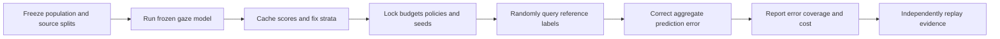
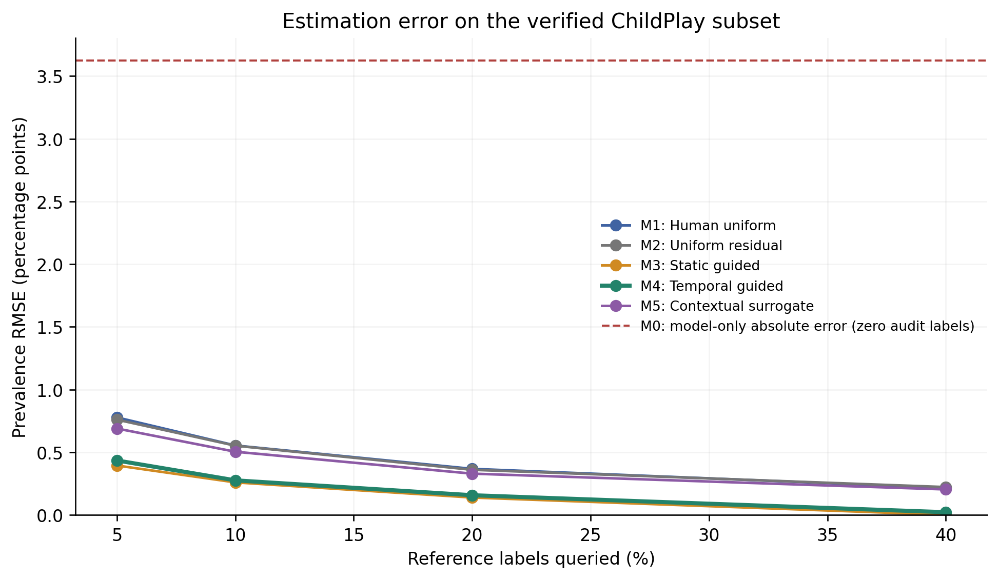
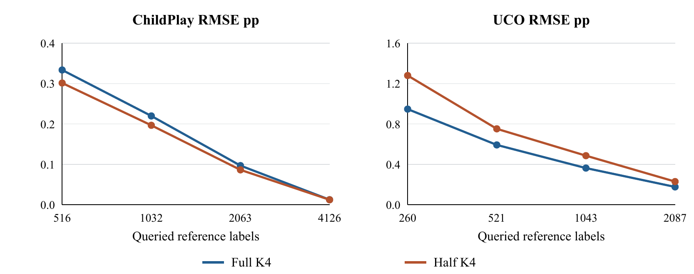
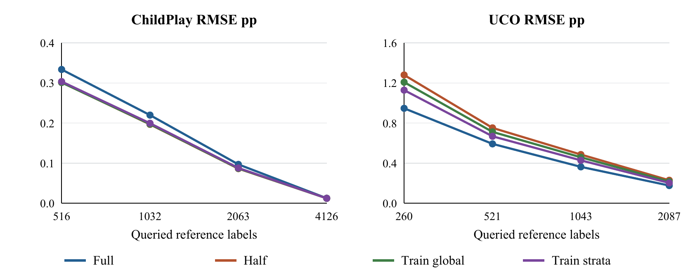
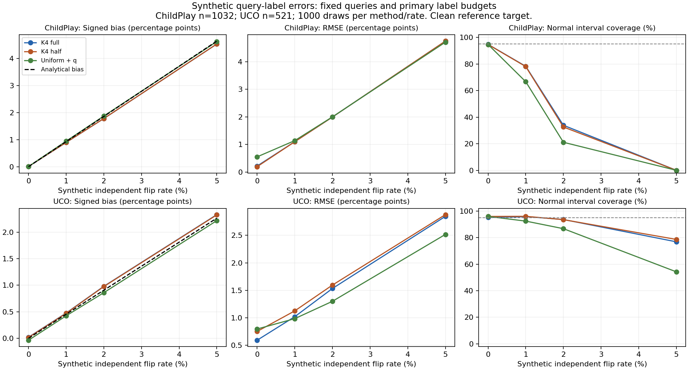
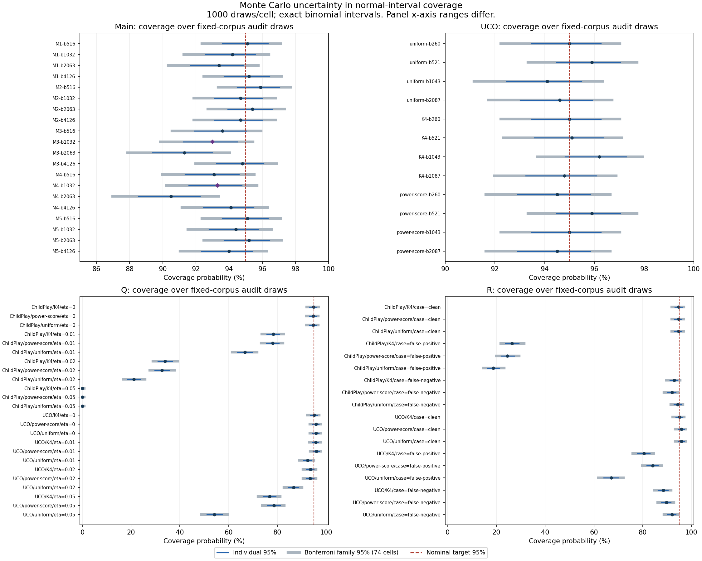

# Reliable Mutual Looking Estimation with Limited Reference Labels

**Group 14 · Image and Video Processing Course Project**

We built a system for estimating **how often an eligible person-pair is looking at each other** in an annotated video population. It combines frozen gaze predictions with a limited, randomized sample of reference labels and corrects the model's aggregate error.

The completed work includes media preparation, frame/person alignment, cached inference, sampling policies, estimation, uncertainty diagnostics, independent replay, a UCO transfer study and local result explorers. The research program is complete through the final training-only coefficient experiment. No further experiments are scheduled.

> **What the results support:** score-guided sampling can reduce estimation error at a fixed label budget. Half-weight correction helps on ChildPlay but loses on UCO. Temporal guidance did not beat the main static control. The target is benchmark-defined mutual looking; this is **not an ADHD diagnostic system**.

## Contents

- [Repository versions](#repository-versions)
- [Key results](#key-results)
- [How the method works](#how-the-method-works)
- [Datasets and budgets](#datasets-and-budgets)
- [Main experiment](#main-experiment)
- [Prediction weighting and transfer](#prediction-weighting-and-transfer)
- [Final training-only extension](#final-training-only-extension)
- [Uncertainty and label quality](#uncertainty-and-label-quality)
- [Complete experiment overview](#complete-experiment-overview)
- [Run the demonstration](#run-the-demonstration)
- [Reproduce the experiments](#reproduce-the-experiments)
- [Evidence and documentation](#evidence-and-documentation)
- [Limitations](#limitations)

## Repository versions

| Version | Purpose |
|---|---|
| `main` | Project landing page and published overview graphs, alongside the historical main-study code. |
| [`codex/project-readme-v1`](https://github.com/SaqlainSQX/adhd_ivp/tree/codex/project-readme-v1) | Full completed research checkout plus this expanded documentation. **Use this branch for the demonstration and commands below.** |
| [`9b35728`](https://github.com/SaqlainSQX/adhd_ivp/tree/9b35728ccfef3390c6f9fa7111a780367dbc5b39) | Fixed research snapshot through the final U experiment, before this landing-page update. |

The landing-page update does not merge all later experimental implementation history into the historical main-study baseline. Deep evidence links use the fixed research snapshot so their meaning remains stable. The previous README is retained in [the documentation provenance archive](assets/readme/README-before-20261110.md); historical scientific results and manifests are unchanged.

## Key results

**Primary budgets: 1,032 queried labels on ChildPlay and 521 on UCO.** Every cell below uses 1,000 simulated audit draws on a frozen population. RMSE is in **percentage points (pp); lower is better**.

| Population | Uniform residual correction | Full-weight score strata K4 | Half-weight K4 | Training-only per-stratum coefficients |
|---|---:|---:|---:|---:|
| ChildPlay | 0.552886 | 0.219884 | **0.196725** | 0.199534 |
| UCO | 0.795989 | **0.592311** | 0.751927 | 0.668021 |

- **ChildPlay weighting gain:** half/full K4 ratio **0.894677**, paired 95% draw-bootstrap interval **[0.871237, 0.919003]**: about **10.5% lower RMSE**, on identical queries.
- **UCO guidance gain:** full K4/uniform correction ratio **0.744119**, interval **[0.700975, 0.792257]**: about **25.6% lower RMSE** at the same label budget, with different sampling designs.
- **Failed weighting transfer:** UCO half/full ratio **1.269481**, interval **[1.220213, 1.319341]**: half weight is about **26.9% worse**.
- **Original temporal hypothesis:** temporal/static ratio **1.062319**, interval **[0.988881, 1.142094]**. This does not establish a temporal gain.

Full K4 has lower observed primary RMSE than uniform correction on both populations. The additional half-weight modification does **not** improve both. These are fixed-corpus comparisons, not a universal ranking or a new-source guarantee.

Sources: [main results](https://github.com/SaqlainSQX/adhd_ivp/blob/9b35728ccfef3390c6f9fa7111a780367dbc5b39/docs/research/main-course-results.json), [D weighting](https://github.com/SaqlainSQX/adhd_ivp/blob/9b35728ccfef3390c6f9fa7111a780367dbc5b39/docs/research/timed-d-result.json), [UCO](https://github.com/SaqlainSQX/adhd_ivp/blob/9b35728ccfef3390c6f9fa7111a780367dbc5b39/docs/research/l-transfer-result.json), [final coefficients](https://github.com/SaqlainSQX/adhd_ivp/blob/9b35728ccfef3390c6f9fa7111a780367dbc5b39/docs/research/u-result.json).

## How the method works



For fixed prediction `phi` and stratum weight `W_h = N_h / N`, the difference estimate is:

```text
estimated prevalence = mean_population(phi)
                     + sum_h W_h * mean_sample_in_h(reference - phi)

estimated variance   = sum_h W_h^2 * (1 - n_h / N_h)
                           * sample_residual_variance_h / n_h
```

The sample residual corrects aggregate model error. Under the stated finite-population randomization and accurate references, the point estimator is design-unbiased even if predictions are miscalibrated. Prediction quality, strata and allocation affect variance. Approximate normal intervals still need empirical validation.

| Component | Choices evaluated |
|---|---|
| Vision predictions | Frozen released MTGS-DINO temporal scores; no new vision-weight training. |
| Guidance | Uniform, learned static/temporal error guidance, native score and entropy strata. |
| Correction | Full, half, validation-selected weight, and training-only global/per-stratum coefficients. |
| Query unit | Pair-frame queries and exploratory contiguous blocks. |
| Uncertainty | Normal, bounded residual, conservative hypergeometric binary reference, coverage diagnostics. |

The native mutual-looking score is the minimum of the two directional looking-at-head scores. **K4** is the frozen four-stratum score design. Development, saved query generation and evaluation-reference use are separated. Control variates, stratification and model-assisted estimation are established methods; the contribution is their implemented and evaluated use in this measurement pipeline.

## Datasets and budgets

| Property | ChildPlay available-media population | UCO evaluation population |
|---|---|---|
| Eligible test pair-frames | 10,316 | 5,219 |
| Positive references | 363 | 1,429 |
| Reference prevalence | 3.5188% | 27.3807% |
| Source scope | 10 test sources | 15 test clips from four TV-show sources |
| Exact label budgets | 516 / 1,032 / 2,063 / 4,126 | 260 / 521 / 1,043 / 2,087 |
| Primary budget | 1,032 | 521 |

All 95 original ChildPlay sources were attempted. The verified subset retained 53: 40 training, three validation and ten test sources, with **191,956 eligible training** and **25,139 validation** pair-frames. Unavailable videos, changed frame counts and unresolved mappings remain documented exclusions.

The target is the mean of eligible binary-known **pair-frame** references. It is not a person-level rate, duration over all footage, prevalence in missing videos or a clinical outcome. Unknown labels and placeholder people are excluded under the data contract.

UCO evaluates a frozen downstream audit recipe, but belongs to the broader pretrained-model data setting. Shared pretraining-family exposure and crop-adapter differences limit independent generalization claims.

## Main experiment

The locked ChildPlay study uses common frozen predictions, explicit estimators and exact budgets. M1/M2/M5 share uniform queries; guided policies retain their own registered designs.

| Method | 516 labels | 1,032 labels | 2,063 labels | 4,126 labels |
|---|---:|---:|---:|---:|
| M1 Uniform references | 0.7784 | 0.5545 | 0.3684 | 0.2168 |
| M2 Uniform residual | 0.7606 | 0.5529 | 0.3607 | 0.2230 |
| M3 Static guided | 0.3950 | 0.2603 | 0.1396 | 0.0019 |
| M4 Temporal guided | 0.4351 | 0.2765 | 0.1580 | 0.0227 |
| M5 Contextual surrogate | 0.6899 | 0.5047 | 0.3300 | 0.2042 |

The uncorrected model mean is **7.1412%**, versus reference prevalence **3.5188%**: **+3.6224 pp bias**. That fixed aggregate error is not another distribution of randomized audits. Census of high-error strata helps explain the very small static error at the largest budget.



The temporal non-win is retained. A five-frame window reaches **0.250358 pp**, versus **0.276528** for the original eleven-frame window. Removing order-sensitive transition/lag features gives **0.275412**. These results do not establish that the extra transition features are essential.

## Prediction weighting and transfer

Full and half K4 use identical references within each corpus/budget comparison. Their behavior differs across populations:



| ChildPlay labels | Full K4 RMSE | Half K4 RMSE | Half/full ratio |
|---:|---:|---:|---:|
| 516 | 0.333759 | 0.301458 | 0.903219 |
| 1,032 | 0.219884 | 0.196725 | 0.894677 |
| 2,063 | 0.096858 | 0.086304 | 0.891040 |
| 4,126 | 0.012371 | 0.012189 | 0.985320 |

The earlier raw-score control reaches 0.207857 pp at the primary budget on a different stream. It is not the same-query denominator for the 10.5% weighting gain.

| UCO labels | Uniform residual RMSE | Full K4 RMSE | Half K4 RMSE |
|---:|---:|---:|---:|
| 260 | 1.163361 | 0.947330 | 1.280219 |
| 521 | 0.795989 | 0.592311 | 0.751927 |
| 1,043 | 0.554482 | 0.362877 | 0.485805 |
| 2,087 | 0.339252 | 0.176287 | 0.229096 |

Half weight loses to full at **every UCO budget**. Full K4 improves over uniform correction at every UCO budget. The post-hoc identity `V(lambda) = A - 2*lambda*B + lambda^2*C` explains why weighting can reverse; it does not select a new test-optimal weight.

## Final training-only extension

Only eligible ChildPlay training rows fit these coefficients. The global coefficient is **0.574914**; the four stratum coefficients are **0, 0, 0.045374 and 0.666164**. No test or UCO label fits or selects them.



- ChildPlay per-stratum/full ratio: **0.907451 [0.891247, 0.924487]**.
- ChildPlay per-stratum/half ratio: **1.014277 [1.004207, 1.024598]**, a loss to the previous half-weight result.
- UCO per-stratum/full ratio: **1.127822 [1.096074, 1.161932]**, a loss to full weight.

This final extension did not establish a new best primary method. All **32,000 audit calculations, five coefficient fits and 24 paired bootstrap comparisons** passed independent checks. Training references remain a development cost.

## Uncertainty and label quality

### Point precision is not interval reliability

Main primary normal coverage is **93.0%** for M3 and **93.3%** for M4. Student-t and validation-scaled intervals do not reliably fix the shortfall. Later score-weighted designs retain severe high-budget undercoverage despite low RMSE: ChildPlay half-weight coverage at 4,126 labels is **39.1%**.

Conservative binary-reference widths are about **10.60 pp** for main M3 and **16.04 pp** for primary UCO K4. They may be too broad for a useful precision claim. They ignore the prediction coefficient and are not generally centered on the residual estimate; points are not clipped into them. Public interval-error allocation improves the registered primary width by only **2.59%**.

### Artificial query-label errors

At a synthetic **2% symmetric flip rate**, full K4 gives:

| Population | Clean RMSE pp | Noisy RMSE pp | Normal clean-target coverage |
|---|---:|---:|---:|
| ChildPlay | 0.2199 | 1.9959 | 33.9% |
| UCO | 0.5923 | 1.5334 | 93.6% |

These rates are sensitivity settings, **not measured annotator accuracy**. Half weighting does not remove label-error bias. In the directional study, ChildPlay full-K4 RMSE is **2.1562 pp** under 2% class-conditional false-positive errors, versus **0.2316 pp** under 2% false-negative errors. Those rates condition on different classes and do not imply equal overall corruption counts.

<details>
<summary>View all symmetric label-error curves</summary>



</details>

### Monte Carlo uncertainty in coverage

The coverage analysis examines **74 saved cells** with **148 exact binomial intervals**. Main M3/M4 at 2,063 labels retain undercoverage flags after the specified family adjustment. At the primary budget, individual bounds exclude 95%, while wider simultaneous bounds include it. Including 95% does not prove nominal reliability.

<details>
<summary>View individual and family intervals for every coverage cell</summary>



</details>

These intervals concern repeated-audit coverage on fixed populations. They are not prevalence intervals, new-source uncertainty or corrections for the entire adaptive research history.

## Complete experiment overview

| Stage | Question | Outcome |
|---|---|---|
| Main | Does temporal guidance beat static guidance? | No primary temporal gain; 20,000 sampled main cases independently replayed. |
| A | Window size and order-sensitive features | Shorter window improves relative to window 11; removing lag/transition features is close to the original temporal result. |
| B | Simple guidance and interval diagnosis | Score quartiles are a strong primary control; entropy is weaker. Coverage failures remain visible. |
| C | Learners and calibration-label cost | Ridge is approximately tied; squared-residual RF is worse at the primary endpoint. One 5% training-label calibration matches the full-label curve, while all validation labels remain charged. |
| D | Coefficients and stratum count | Half weight helps on identical ChildPlay K4 queries. Validation-selected K8 loses to K4 at the primary test budget. |
| E | Source sensitivity | Only three of six positive-reference sources improve. One influential source largely controls the aggregate gain; overlapping leave-source-out results are not unseen-source CV. |
| F | Conservative interval error allocation | About 2.59% primary width improvement; broad intervals remain. |
| G | Contiguous blocks and block guidance | Uniform length-five blocks have about 2.11 times frame-query RMSE at matched expected cost. Temporal/static guided-block ratio 1.1139 is a loss. Realized costs vary. |
| H | Research explorer | Inspection of budgets, estimates, coverage, saved replay and provided-track frames. |
| I–K | External-source feasibility and mapping | No accepted local unseen source. UCO needs documented frame/person/geometry checks; failed attempts are retained. |
| L | UCO transfer | Full K4 beats uniform correction; the ChildPlay half-weight gain reverses. |
| M | Exact variance explanation | Explains the two fixed weights without selecting a test-optimal replacement. |
| N–P | Aggregate reproduction | Source-only presentation build and explicit checks for missing/changed inputs, including optimized Python. |
| Q–R | Symmetric and directional errors | Rare positives are sensitive to false-positive errors. No human annotation error rate is estimated. |
| S | Reporting synthesis | 93 numeric claims checked against 14 accepted aggregates, with display and link checks. |
| T | Coverage reliability | Individual/family Monte Carlo intervals quantify finite-draw uncertainty and persistent failures. |
| U | Training-only coefficients | Helps relative to full on ChildPlay but loses to half; helps relative to half on UCO but loses to full. Last authorized run. |

The course contribution is the implemented audit system, controlled comparisons, transfer and robustness study, and replayable evidence. It does not rely on claiming a new statistical theorem or universal superiority.

## Run the demonstration

### Get the full checkout

```powershell
git clone --branch codex/project-readme-v1 https://github.com/SaqlainSQX/adhd_ivp.git
cd adhd_ivp
```

This branch includes the completed research scripts. The landing-page update on `main` alone is not a merge of every later experimental implementation.

### Rebuild and serve the aggregate transfer appendix

With Python available, from the repository root:

```powershell
python -I -S scripts/build_verified_transfer_appendix.py
python -I -S scripts/serve_transfer_appendix.py --port 8768
```

Open **http://127.0.0.1:8768**. Reuse an existing service instead of starting a duplicate. This path uses tracked aggregates and standard-library Python: no raw media, model weights, Kaggle credentials or GPU packages are needed. It reproduces presentation data, **not the full vision experiment**.

The optional earlier explorer uses the installed project dependencies. With `uv` available:

```powershell
uv sync --frozen --extra dev --extra demo
uv run python scripts/serve_research_demo.py --aggregate-only --port 8766
```

Open **http://127.0.0.1:8766**. This command starts aggregate-only mode. Frame/replay views need separately prepared local data and the corresponding full-mode setup. The historical interfaces do not automatically include the final U addendum.

### Try the software with synthetic data

The package supports Python 3.11 or newer. With `uv` installed:

```powershell
uv sync --frozen --extra dev
uv run pytest
uv run gaze-audit demo --draws 100 --output outputs/demo-new
```

Use a new output directory. The provisional demo's invented scores and labels must not be presented as the real experimental results above.

## Reproduce the experiments

Full scientific replay requires the prepared datasets, frozen prediction caches, saved query files and pinned inference environment. Large or restricted inputs are not distributed in Git. Follow the [run instructions](https://github.com/SaqlainSQX/adhd_ivp/blob/9b35728ccfef3390c6f9fa7111a780367dbc5b39/docs/RUN_EXPERIMENTS.md) and [data contract](https://github.com/SaqlainSQX/adhd_ivp/blob/9b35728ccfef3390c6f9fa7111a780367dbc5b39/docs/data-contract.md).

1. Obtain authorized annotations/media and verify checksums.
2. Normalize identities, eligibility and frame mapping; preserve source splits and exclusions.
3. Produce frozen, provenance-checked prediction caches.
4. Fit/select the registered policy using its development data only.
5. Save query plans and hashes before evaluation-reference use.
6. Evaluate the fixed population, budgets, seeds and endpoints.
7. Independently replay selections, estimates, variances, intervals and comparisons.
8. Save reports and manifests in a new versioned output; retain failures.

Many runners refuse to overwrite registered output folders. A repeat requires a **new output/config version**; do not delete accepted evidence to rerun a command. Aggregate rebuilding, audit replay and fresh model inference are different reproduction levels.

| Component | Validation saved |
|---|---|
| Main study | 20,000 sampled audits independently replayed. |
| UCO transfer | 12,000 audits, exact integer-interval verification and bootstrap replay. |
| Symmetric errors | 24,000 cases and 24 exhaustive toy moment cases. |
| Directional errors | 18,000 cases and 18 exhaustive toy cases. |
| Coverage diagnostics | 148 intervals checked with independent binomial sums and boundary formulas. |
| Final coefficients | 32,000 audit calculations, five independent fits and 24 paired bootstraps. |
| Aggregate integrity | Intact/changed/missing copied inputs under normal and optimized Python. |

These counts overlap across studies. Do not add them as independent people, new videos or newly collected labels.

## Evidence and documentation

Each link below points to the fixed completed research snapshot.

| Document | Purpose |
|---|---|
| [Checked course guide](https://github.com/SaqlainSQX/adhd_ivp/blob/9b35728ccfef3390c6f9fa7111a780367dbc5b39/docs/COURSE_PROJECT_GUIDE_S.md) | Pipeline, contribution, numeric evidence, report structure and viva questions. |
| [Final handoff](https://github.com/SaqlainSQX/adhd_ivp/blob/9b35728ccfef3390c6f9fa7111a780367dbc5b39/docs/FINAL_PROJECT_HANDOFF.md) | Stopping decision and course-submission recommendation. |
| [Main report](https://github.com/SaqlainSQX/adhd_ivp/blob/9b35728ccfef3390c6f9fa7111a780367dbc5b39/reports/course-project/course-report.md) | Locked comparison and complete original budget tables. |
| [Strengthening](https://github.com/SaqlainSQX/adhd_ivp/blob/9b35728ccfef3390c6f9fa7111a780367dbc5b39/reports/course-project/strengthening-report.md) | Score/entropy controls and interval diagnostics. |
| [UCO results](https://github.com/SaqlainSQX/adhd_ivp/blob/9b35728ccfef3390c6f9fa7111a780367dbc5b39/docs/UCO_TRANSFER_L_RESULTS.md) | Transfer gain, weighting loss, preparation and scope. |
| [Variance explanation](https://github.com/SaqlainSQX/adhd_ivp/blob/9b35728ccfef3390c6f9fa7111a780367dbc5b39/docs/VARIANCE_EXPLANATION_M_RESULTS.md) | Why fixed weights can behave differently across corpora. |
| [Symmetric errors](https://github.com/SaqlainSQX/adhd_ivp/blob/9b35728ccfef3390c6f9fa7111a780367dbc5b39/docs/QUERY_NOISE_Q_RESULTS.md) / [Directional errors](https://github.com/SaqlainSQX/adhd_ivp/blob/9b35728ccfef3390c6f9fa7111a780367dbc5b39/docs/DIRECTIONAL_NOISE_R_RESULTS.md) | All artificial rates, methods and clean-target failures. |
| [Coverage uncertainty](https://github.com/SaqlainSQX/adhd_ivp/blob/9b35728ccfef3390c6f9fa7111a780367dbc5b39/docs/COVERAGE_MC_T_RESULTS.md) | Monte Carlo uncertainty and its interpretation limits. |
| [Final coefficient experiment](https://github.com/SaqlainSQX/adhd_ivp/blob/9b35728ccfef3390c6f9fa7111a780367dbc5b39/docs/STRATUM_WEIGHTS_U_RESULTS.md) | All 32 final cells, 24 comparisons and training-only fit. |
| [Verified team build](https://github.com/SaqlainSQX/adhd_ivp/blob/9b35728ccfef3390c6f9fa7111a780367dbc5b39/docs/TEAM_VERIFIED_BUILD_P.md) | Integrity-checked aggregate reproduction using standard-library Python. |
| [Execution plan](https://github.com/SaqlainSQX/adhd_ivp/blob/9b35728ccfef3390c6f9fa7111a780367dbc5b39/docs/COURSE_PROJECT_PLAN.md) | Processing stages, budgets and gates. |
| [Primary-source evidence matrix](https://github.com/SaqlainSQX/adhd_ivp/blob/9b35728ccfef3390c6f9fa7111a780367dbc5b39/docs/research/evidence-matrix.md) | Literature, prior overlap and limits of novelty claims. |
| [Aggregate evidence](https://github.com/SaqlainSQX/adhd_ivp/tree/9b35728ccfef3390c6f9fa7111a780367dbc5b39/docs/research) | Machine-readable results, protocols, proofs and manifests. |

## Repository layout

The full research checkout contains:

```text
src/gaze_audit/           Estimation, inference, adapters and validation
scripts/                 Registered runners, independent validators and demos
configs/                 Frozen settings and input hashes
docs/                    Methodology, protocols, guides and limitations
docs/research/           Accepted aggregate results and evidence manifests
reports/course-project/  Reports and scientific figures
demo/                    Research explorer and transfer appendix
assets/readme/           Published overview figures and provenance
tests/                   Statistical, data-boundary and software checks
data/                    Local datasets and references, excluded from Git
outputs/                 Local run artifacts, excluded from Git
checkpoints/             Local vision weights, excluded from Git
```

## Limitations

- **Selected populations:** available media and binary-known eligibility define the target. Auditing that subset cannot recover missing-source prevalence.
- **Exploratory history:** later studies reuse inspected populations. New registrations freeze settings but do not supply untouched confirmation.
- **Source dependence:** many pair-frames come from few sources; leave-source-out diagnostics overlap.
- **Transfer scope:** UCO is not an untouched pretraining-domain or clinical evaluation, and crop conventions differ.
- **Reference assumptions:** synthetic errors are not measured human errors. No timed human labeling study or clinical validation was performed.
- **Uncertainty:** low RMSE and narrow intervals do not prove nominal coverage. Conservative alternatives can be very broad.
- **Costs:** training/validation labels and pretrained supervision are additional to audit labels. Blocks match expected cost, not every realized count.
- **Reproduction:** the aggregate build was checked on the project PC, not a fresh cross-platform setup. The physical in-app download-capture helper timed out, although its JSON endpoint/payload was checked.

## Data and prior work

- [MTGS official model and checkpoints](https://github.com/idiap/MTGS)
- [VSGaze annotation release](https://zenodo.org/records/17357752)
- [ChildPlay benchmark paper](https://publications.idiap.ch/downloads/papers/2023/Tafasca_ICCV_2023.pdf)
- [UCO-LAEO official data and protocol](https://github.com/AVAuco/ucolaeodb)
- [Prediction-powered inference](https://www.stat.ubc.ca/~john/papers/AngelopoulosScience2023.pdf)
- [Active statistical inference](https://proceedings.mlr.press/v235/zrnic24a.html)

Upstream models, data and established statistical methods remain credited to their original authors. Project-code licensing has not yet been selected by the team; upstream data/model terms are separate. Repository access does not grant permission to redistribute media or checkpoints.

## Team workflow and data hygiene

Use feature branches and reviewable changes; see [CONTRIBUTING.md](CONTRIBUTING.md). Preserve accepted registrations and scientific results. Use versioned outputs for repairs/reruns. Do not commit credentials, raw media, reference tables, per-query artifacts, environments or vision weights.

The research run is finished and the recurring continuation is paused. This documentation update does not restart experiments.
