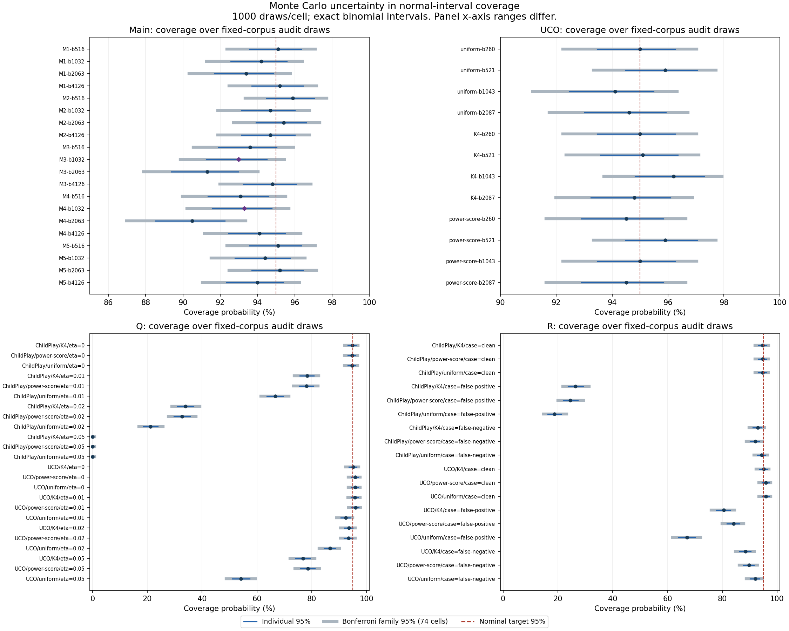

# T: Monte Carlo uncertainty in normal-interval coverage

This deterministic reliability analysis uses all74 registered saved
coverage cells. No new models, queries, labels or predictions were made.
The family/counts/code were committed at2663c37 before T endpoints.
All original coverages were already inspected: this is exploratory
diagnosis, not fresh confirmation or a correction to the intervals.

## Primary main-study cells

| Main method/budget | Observed % | Individual95% MC interval % | Family95% MC interval % |
|---|---:|---|---|
| M3-b1032 | 93.0000 | [91.2384, 94.5028] | [89.8520, 95.4428] |
| M4-b1032 | 93.3000 | [91.5690, 94.7702] | [90.2039, 95.6857] |

Both primary individual upper bounds are below95%; neither family
upper bound is below95%. The wider simultaneous intervals do not
establish nominal coverage. They express uncertainty in a coverage
probability over random audits, not in prevalence or future domains.

Main M3-b2063 and M4-b2063 retain upper bounds below95% even with the
registered family adjustment. Do not hide them or imply all main
intervals have demonstrated reliable nominal coverage.

## Complete diagnostic counts

| Group | Cells | Individual undercoverage flags | Family undercoverage flags |
|---|---:|---:|---:|
| Main | 20 | 6 | 2 |
| UCO | 12 | 0 | 0 |
| Q | 24 | 15 | 14 |
| R | 18 | 11 | 10 |

No individual or family overcoverage flag occurs in this normal-interval
family. Cells are dependent and include repeated clean controls; counts
are diagnostic cells, not independent discoveries. UCO having no flags
does not prove coverage equals or exceeds95%.

## Every registered cell

All endpoints below use percent; each cell has1000 draws. Flag means
the interval's upper endpoint is below95%. All endpoints are retained
at full precision in the aggregate JSON.

| Group | Cell | k/n | Observed % | Individual95% MC interval % | Family95% MC interval % | Individual flag | Family flag |
|---|---|---|---:|---|---|---|---|
| Main | M1-b516 | 951/1000 | 95.10 | [93.5734, 96.3533] | [92.3508, 97.1068] | False | False |
| Main | M1-b1032 | 942/1000 | 94.20 | [92.5664, 95.5667] | [91.2690, 96.4047] | False | False |
| Main | M1-b2063 | 934/1000 | 93.40 | [91.6794, 94.8591] | [90.3215, 95.7663] | True | False |
| Main | M1-b4126 | 952/1000 | 95.20 | [93.6860, 96.4400] | [92.4722, 97.1836] | False | False |
| Main | M2-b516 | 959/1000 | 95.90 | [94.4788, 97.0420] | [93.3298, 97.7130] | False | False |
| Main | M2-b1032 | 947/1000 | 94.70 | [93.1245, 96.0051] | [91.8677, 96.7971] | False | False |
| Main | M2-b2063 | 954/1000 | 95.40 | [93.9116, 96.6129] | [92.7158, 97.3364] | False | False |
| Main | M2-b4126 | 947/1000 | 94.70 | [93.1245, 96.0051] | [91.8677, 96.7971] | False | False |
| Main | M3-b516 | 936/1000 | 93.60 | [91.9005, 95.0367] | [90.5573, 95.9270] | False | False |
| Main | M3-b1032 | 930/1000 | 93.00 | [91.2384, 94.5028] | [89.8520, 95.4428] | True | False |
| Main | M3-b2063 | 913/1000 | 91.30 | [89.3792, 92.9732] | [87.8826, 94.0415] | True | True |
| Main | M3-b4126 | 948/1000 | 94.80 | [93.2365, 96.0923] | [91.9881, 96.8749] | False | False |
| Main | M4-b516 | 931/1000 | 93.10 | [91.3485, 94.5921] | [89.9691, 95.5239] | True | False |
| Main | M4-b1032 | 933/1000 | 93.30 | [91.5690, 94.7702] | [90.2039, 95.6857] | True | False |
| Main | M4-b2063 | 905/1000 | 90.50 | [88.5115, 92.2460] | [86.9681, 93.3695] | True | True |
| Main | M4-b4126 | 941/1000 | 94.10 | [92.4551, 95.4787] | [91.1499, 96.3256] | False | False |
| Main | M5-b516 | 951/1000 | 95.10 | [93.5734, 96.3533] | [92.3508, 97.1068] | False | False |
| Main | M5-b1032 | 944/1000 | 94.40 | [92.7892, 95.7424] | [91.5079, 96.5623] | False | False |
| Main | M5-b2063 | 952/1000 | 95.20 | [93.6860, 96.4400] | [92.4722, 97.1836] | False | False |
| Main | M5-b4126 | 940/1000 | 94.00 | [92.3440, 95.3905] | [91.0310, 96.2463] | False | False |
| UCO | uniform-b260 | 950/1000 | 95.00 | [93.4610, 96.2665] | [92.2296, 97.0298] | False | False |
| UCO | uniform-b521 | 959/1000 | 95.90 | [94.4788, 97.0420] | [93.3298, 97.7130] | False | False |
| UCO | uniform-b1043 | 941/1000 | 94.10 | [92.4551, 95.4787] | [91.1499, 96.3256] | False | False |
| UCO | uniform-b2087 | 946/1000 | 94.60 | [93.0126, 95.9177] | [91.7475, 96.7191] | False | False |
| UCO | K4-b260 | 950/1000 | 95.00 | [93.4610, 96.2665] | [92.2296, 97.0298] | False | False |
| UCO | K4-b521 | 951/1000 | 95.10 | [93.5734, 96.3533] | [92.3508, 97.1068] | False | False |
| UCO | K4-b1043 | 962/1000 | 96.20 | [94.8213, 97.2971] | [93.7022, 97.9351] | False | False |
| UCO | K4-b2087 | 948/1000 | 94.80 | [93.2365, 96.0923] | [91.9881, 96.8749] | False | False |
| UCO | power-score-b260 | 945/1000 | 94.50 | [92.9008, 95.8301] | [91.6276, 96.6408] | False | False |
| UCO | power-score-b521 | 959/1000 | 95.90 | [94.4788, 97.0420] | [93.3298, 97.7130] | False | False |
| UCO | power-score-b1043 | 950/1000 | 95.00 | [93.4610, 96.2665] | [92.2296, 97.0298] | False | False |
| UCO | power-score-b2087 | 945/1000 | 94.50 | [92.9008, 95.8301] | [91.6276, 96.6408] | False | False |
| Q | ChildPlay/K4/eta=0 | 948/1000 | 94.80 | [93.2365, 96.0923] | [91.9881, 96.8749] | False | False |
| Q | ChildPlay/power-score/eta=0 | 947/1000 | 94.70 | [93.1245, 96.0051] | [91.8677, 96.7971] | False | False |
| Q | ChildPlay/uniform/eta=0 | 947/1000 | 94.70 | [93.1245, 96.0051] | [91.8677, 96.7971] | False | False |
| Q | ChildPlay/K4/eta=0.01 | 783/1000 | 78.30 | [75.6138, 80.8185] | [73.6001, 82.5397] | True | True |
| Q | ChildPlay/power-score/eta=0.01 | 781/1000 | 78.10 | [75.4059, 80.6275] | [73.3871, 82.3559] | True | True |
| Q | ChildPlay/uniform/eta=0.01 | 667/1000 | 66.70 | [63.6831, 69.6182] | [61.4637, 71.6652] | True | True |
| Q | ChildPlay/K4/eta=0.02 | 339/1000 | 33.90 | [30.9671, 36.9280] | [28.9077, 39.1537] | True | True |
| Q | ChildPlay/power-score/eta=0.02 | 326/1000 | 32.60 | [29.6996, 35.6033] | [27.6676, 37.8149] | True | True |
| Q | ChildPlay/uniform/eta=0.02 | 211/1000 | 21.10 | [18.6092, 23.7622] | [16.9099, 25.7602] | True | True |
| Q | ChildPlay/K4/eta=0.05 | 0/1000 | 0.00 | [0.0000, 0.3682] | [0.0000, 0.7961] | True | True |
| Q | ChildPlay/power-score/eta=0.05 | 0/1000 | 0.00 | [0.0000, 0.3682] | [0.0000, 0.7961] | True | True |
| Q | ChildPlay/uniform/eta=0.05 | 0/1000 | 0.00 | [0.0000, 0.3682] | [0.0000, 0.7961] | True | True |
| Q | UCO/K4/eta=0 | 951/1000 | 95.10 | [93.5734, 96.3533] | [92.3508, 97.1068] | False | False |
| Q | UCO/power-score/eta=0 | 959/1000 | 95.90 | [94.4788, 97.0420] | [93.3298, 97.7130] | False | False |
| Q | UCO/uniform/eta=0 | 959/1000 | 95.90 | [94.4788, 97.0420] | [93.3298, 97.7130] | False | False |
| Q | UCO/K4/eta=0.01 | 958/1000 | 95.80 | [94.3650, 96.9565] | [93.2064, 97.6383] | False | False |
| Q | UCO/power-score/eta=0.01 | 960/1000 | 96.00 | [94.5927, 97.1272] | [93.4536, 97.7874] | False | False |
| Q | UCO/uniform/eta=0.01 | 924/1000 | 92.40 | [90.5796, 93.9656] | [89.1524, 94.9528] | True | True |
| Q | UCO/K4/eta=0.02 | 936/1000 | 93.60 | [91.9005, 95.0367] | [90.5573, 95.9270] | False | False |
| Q | UCO/power-score/eta=0.02 | 935/1000 | 93.50 | [91.7899, 94.9480] | [90.4393, 95.8467] | True | False |
| Q | UCO/uniform/eta=0.02 | 867/1000 | 86.70 | [84.4371, 88.7442] | [82.7059, 90.0955] | True | True |
| Q | UCO/K4/eta=0.05 | 768/1000 | 76.80 | [74.0570, 79.3842] | [72.0066, 81.1577] | True | True |
| Q | UCO/power-score/eta=0.05 | 786/1000 | 78.60 | [75.9257, 81.1047] | [73.9198, 82.8150] | True | True |
| Q | UCO/uniform/eta=0.05 | 542/1000 | 54.20 | [51.0534, 57.3218] | [48.7773, 59.5545] | True | True |
| R | ChildPlay/K4/case=clean | 948/1000 | 94.80 | [93.2365, 96.0923] | [91.9881, 96.8749] | False | False |
| R | ChildPlay/power-score/case=clean | 947/1000 | 94.70 | [93.1245, 96.0051] | [91.8677, 96.7971] | False | False |
| R | ChildPlay/uniform/case=clean | 947/1000 | 94.70 | [93.1245, 96.0051] | [91.8677, 96.7971] | False | False |
| R | ChildPlay/K4/case=false-positive | 264/1000 | 26.40 | [23.6907, 29.2490] | [21.8166, 31.3669] | True | True |
| R | ChildPlay/power-score/case=false-positive | 245/1000 | 24.50 | [21.8626, 27.2884] | [20.0465, 29.3680] | True | True |
| R | ChildPlay/uniform/case=false-positive | 187/1000 | 18.70 | [16.3283, 21.2575] | [14.7229, 23.1866] | True | True |
| R | ChildPlay/K4/case=false-negative | 929/1000 | 92.90 | [91.1284, 94.4135] | [89.7350, 95.3615] | True | False |
| R | ChildPlay/power-score/case=false-negative | 920/1000 | 92.00 | [90.1420, 93.6058] | [88.6888, 94.6232] | True | True |
| R | ChildPlay/uniform/case=false-negative | 944/1000 | 94.40 | [92.7892, 95.7424] | [91.5079, 96.5623] | False | False |
| R | UCO/K4/case=clean | 951/1000 | 95.10 | [93.5734, 96.3533] | [92.3508, 97.1068] | False | False |
| R | UCO/power-score/case=clean | 959/1000 | 95.90 | [94.4788, 97.0420] | [93.3298, 97.7130] | False | False |
| R | UCO/uniform/case=clean | 959/1000 | 95.90 | [94.4788, 97.0420] | [93.3298, 97.7130] | False | False |
| R | UCO/K4/case=false-positive | 805/1000 | 80.50 | [77.9060, 82.9130] | [75.9528, 84.5508] | True | True |
| R | UCO/power-score/case=false-positive | 841/1000 | 84.10 | [81.6838, 86.3134] | [79.8490, 87.7954] | True | True |
| R | UCO/uniform/case=false-positive | 671/1000 | 67.10 | [64.0908, 70.0082] | [61.8758, 72.0466] | True | True |
| R | UCO/K4/case=false-negative | 885/1000 | 88.50 | [86.3584, 90.4117] | [84.7100, 91.6613] | True | True |
| R | UCO/power-score/case=false-negative | 898/1000 | 89.80 | [87.7555, 91.6065] | [86.1736, 92.7759] | True | True |
| R | UCO/uniform/case=false-negative | 920/1000 | 92.00 | [90.1420, 93.6058] | [88.6888, 94.6232] | True | True |

## Verification and interpretation limits

All three elementary reference cases passed before scientific endpoints
(maximum error2.43e-17). The independent standard-library validator
imports no beta quantile: it uses log-binomial sums at284 interior
endpoints and elementary boundary expressions at12 endpoints. All148
intervals/74 counts, selectors, alpha allocation, flags and summaries
passed; maximum tail/boundary error1.66e-14. All four input hashes and
358 prior manifest entries plus locked main result/policy hashes
remain intact. Ruff passes. The four-panel PNG was visually inspected
for labels, nominal reference, interval widths and differing x-axis
ranges. PDF uses the same plot. Purple diamonds mark the primary cells.

Clopper-Pearson intervals concern the Bernoulli Monte Carlo coverage
under the saved randomization model. The Bonferroni allocation uses
alpha/74 and is conservative under between-cell dependence for a fixed
family. This exploratory diagnostic family does not adjust for the
broader adaptive research history, earlier policy exploration or prior
inspection of the original coverages. It is not a new confirmatory test.

A prevalence interval, an RMSE-ratio bootstrap interval and an interval
for repeated-audit coverage answer different questions. T cannot fix
bias, prove domain generalization or validate real annotator accuracy.
Q/R synthetic-label clean-target failures remain assumption stress tests.
An interval containing95% is lack of a detected departure at that level,
not acceptance of nominal reliability. No policy is replaced or tuned.

Reproduce in a new versioned output/config: run scripts/run_coverage_mc.py,
then scripts/validate_coverage_mc.py (standard-library, -I -S supported).
Plot with the Matplotlib environment using scripts/report_coverage_mc.py.
The runner refuses to overwrite evidence. Accepted aggregate outputs
and proofs are tracked under docs/research/t-*; no raw labels are needed
for this analysis. Source hashes and exact selectors are in the config.

Next U preregisters training-only global/per-stratum control-variate
coefficients, with frozen allocations and no test-selected weights.

