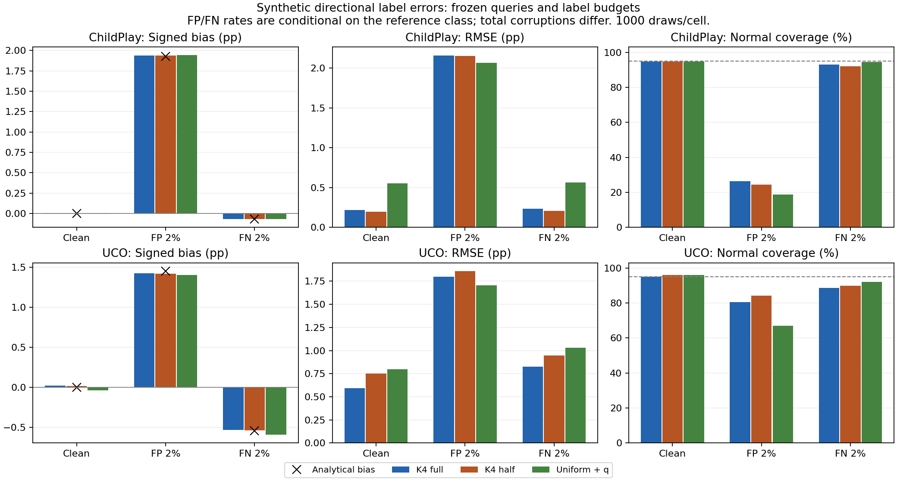

# R: directional label-error sensitivity results

False-positive and false-negative errors have different consequences for
a rare reference outcome. In this synthetic study, 2% class-conditional
false-positive errors cause much more upward bias than the downward bias
from 2% false-negative errors. These settings have different total error
counts. This is an assumption check, not a fair comparison of annotators
at matched overall accuracy or an improved estimation method.

The configuration and implementation were committed at bf7f1b4 before
outcomes. The three registered cases, 1000 fixed queries per case/method,
weights, primary budgets (ChildPlay1032; UCO521), source populations and
new fixed noise seeds were used without tuning. No GPU/Kaggle work.

## Primary full-K4 endpoints

| Dataset | Case | Bias pp | Analytical bias pp | Approx. MC SE pp | RMSE pp | Normal coverage % | Mean queried flips |
|---|---|---:|---:|---:|---:|---:|---:|
| ChildPlay | clean | 0.0048 | 0.0000 | 0.0068 | 0.2199 | 94.8000 | 0.0000 |
| ChildPlay | false-positive | 1.9382 | 1.9296 | 0.0291 | 2.1562 | 26.4000 | 17.7790 |
| ChildPlay | false-negative | -0.0689 | -0.0704 | 0.0069 | 0.2316 | 92.9000 | 2.9520 |
| UCO | clean | 0.0194 | 0.0000 | 0.0191 | 0.5923 | 95.1000 | 0.0000 |
| UCO | false-positive | 1.4248 | 1.4524 | 0.0353 | 1.7985 | 80.5000 | 5.5990 |
| UCO | false-negative | -0.5363 | -0.5476 | 0.0203 | 0.8272 | 88.5000 | 4.7920 |

MC SE uses the joint analytical variance divided by1000; it is not
a source-level confidence interval. Common observations make method/case
cells dependent. Finite-draw deviations from expected bias are preserved.

ChildPlay full-K4 normal coverage falls from94.8% clean to26.4% under
false-positive errors, versus92.9% under false-negative errors. UCO falls
from95.1% to80.5% and88.5%, respectively. Full/half K4 share exactly the
same queries and corrupted observations. Weight reduction does not remove
the expected bias a*(1-mu)-b*mu and gives no new robustness guarantee.

## All registered cells

All bias/RMSE/width columns use percentage points; coverage uses percent.
FP means reference0 flips to1 with probability0.02; FN means reference1
flips to0 with probability0.02. The other class has zero error in each case.

| Dataset | Method | Case | Bias | RMSE | Normal coverage | Normal width | Binary coverage | Binary width | Mean flips |
|---|---|---|---:|---:|---:|---:|---:|---:|---:|
| ChildPlay | K4 full | clean | 0.0048 | 0.2199 | 94.8000 | 0.8416 | 99.6000 | 8.6978 | 0.0000 |
| ChildPlay | K4 half | clean | 0.0067 | 0.1967 | 94.7000 | 0.7462 | 99.6000 | 8.6978 | 0.0000 |
| ChildPlay | Uniform + q | clean | 0.0066 | 0.5529 | 94.7000 | 2.1247 | 95.4000 | 2.2241 | 0.0000 |
| ChildPlay | K4 full | false-positive | 1.9382 | 2.1562 | 26.4000 | 3.3131 | 56.2000 | 11.3437 | 17.7790 |
| ChildPlay | K4 half | false-positive | 1.9402 | 2.1532 | 24.5000 | 3.2844 | 56.2000 | 11.3437 | 17.7790 |
| ChildPlay | Uniform + q | false-positive | 1.9418 | 2.0636 | 18.7000 | 2.6442 | 12.8000 | 2.7179 | 19.9710 |
| ChildPlay | K4 full | false-negative | -0.0689 | 0.2316 | 92.9000 | 0.8412 | 99.8000 | 8.6877 | 2.9520 |
| ChildPlay | K4 half | false-negative | -0.0670 | 0.2084 | 92.0000 | 0.7417 | 99.8000 | 8.6877 | 2.9520 |
| ChildPlay | Uniform + q | false-negative | -0.0674 | 0.5609 | 94.4000 | 2.1336 | 94.3000 | 2.2022 | 0.7640 |
| UCO | K4 full | clean | 0.0194 | 0.5923 | 95.1000 | 2.3687 | 99.4000 | 16.0359 | 0.0000 |
| UCO | K4 half | clean | 0.0146 | 0.7519 | 95.9000 | 3.0898 | 99.4000 | 16.0359 | 0.0000 |
| UCO | Uniform + q | clean | -0.0375 | 0.7960 | 95.9000 | 3.2053 | 95.5000 | 7.4136 | 0.0000 |
| UCO | K4 full | false-positive | 1.4248 | 1.7985 | 80.5000 | 3.9844 | 98.5000 | 17.4383 | 5.5990 |
| UCO | K4 half | false-positive | 1.4199 | 1.8571 | 84.1000 | 4.4644 | 98.5000 | 17.4383 | 5.5990 |
| UCO | Uniform + q | false-positive | 1.4040 | 1.7066 | 67.1000 | 3.7007 | 87.8000 | 7.5282 | 7.5100 |
| UCO | K4 full | false-negative | -0.5363 | 0.8272 | 88.5000 | 2.4842 | 99.8000 | 16.0366 | 4.7920 |
| UCO | K4 half | false-negative | -0.5411 | 0.9449 | 89.8000 | 3.1357 | 99.8000 | 16.0366 | 4.7920 |
| UCO | Uniform + q | false-negative | -0.5959 | 1.0314 | 92.0000 | 3.3733 | 94.2000 | 7.3669 | 2.9090 |

## Checks and reproducibility

All18 exhaustive toy moment cases pass, including census observation
noise (maximum error4.17e-17). All6000 clean controls match Q's saved
point/variance/normal/exact endpoints before directional outcomes. The
independent validator uses XOR corruption, fresh RNG reconstruction,
scalar residual sums/squares and exhaustive feasible integer intervals.
It checks all18000 draws and every summary field,
including304 distinct integer interval cases.
Maximum point difference: 1.67e-16; variance:
1e-16. Analytical bias/variance/MSE were checked
using a separate dot-product formulation. All25 pinned inputs and the
locked main result/policy hashes remain unchanged. Ruff passes. The PNG
was visually reviewed for readable class labels, units and analytical
markers; PDF uses the same figure. No failed R scientific stage occurred.

Commands from the project root:

```powershell
.venv/Scripts/python.exe scripts/run_directional_noise.py
.venv/Scripts/python.exe scripts/validate_directional_noise.py
.venv-mtgs/Scripts/python.exe scripts/report_directional_noise.py
```

The runner refuses to overwrite its output directory. Any fresh rerun
must use a new versioned output/config. Registration, complete aggregate
result, toy/clean/replay proofs and logs are tracked under docs/research/r-*.
Per-draw logs, reference labels and noise vectors are excluded from Git.

## Interpretation limits

A rare positive prevalence makes even a small false-positive probability
important for prevalence estimates. A possible implication is to check
both error directions during real annotation quality control. This study
does not measure annotator error rates or validate any quality-control policy.
The naive exact-binary intervals still target a corrupted population;
clean-target coverage is not guaranteed, even when wide intervals cover.
Class-conditional errors here are independent across records; human errors
may be correlated, source-dependent or systematically ambiguous. Reference
labels are treated as clean only for simulation. No new held-out evidence,
diagnostic inference, selected correction or universal method gain follows.
The original main study, all transfer losses and every Q/R cell remain intact.

Next registered stage S consolidates accepted evidence into a defensible
course report and checked claim map. It creates no new empirical outcomes.


