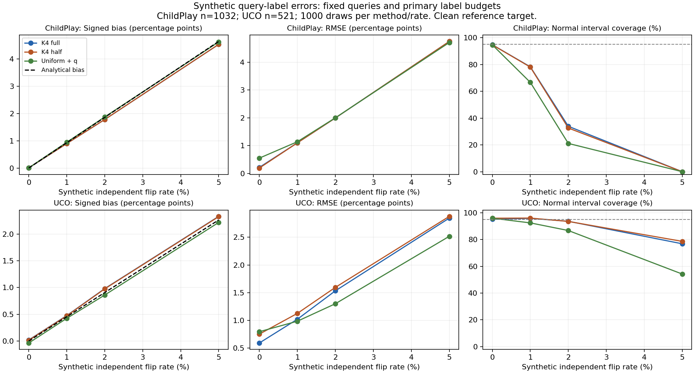

# Q: synthetic label-error sensitivity results

The audit depends on accurate queried labels. Synthetic symmetric errors
substantially harm the clean-reference target; this stage shows a limitation,
not a performance improvement. Frozen full/half K4 and uniform+q queries,
budgets1032/521 and1000 draws were reused with no model fitting or rate selection.

At the primary2% flip setting, full K4 signed bias is+1.7807 percentage
points on ChildPlay (analytical+1.8592), versus+0.0048 with clean labels.
UCO bias is+0.9788 (analytical+0.9048), versus+0.0194 clean. ChildPlay
full-K4 RMSE increases0.2199 to1.9959 points and normal95% coverage falls
94.8% to33.9%. UCO RMSE increases0.5923 to1.5334 and coverage95.1% to93.6%.

All prespecified cells follow. Bias, RMSE and width use percentage points;
coverage is percent. Half denotes0.5q on the same K4 queries. Uniform uses q.

| Dataset | Method | Flip % | Bias | RMSE | Normal coverage | Normal width | Naive binary coverage | Binary width |
|---|---|---:|---:|---:|---:|---:|---:|---:|
| ChildPlay | K4 full | 0.0000 | 0.0048 | 0.2199 | 94.8000 | 0.8416 | 99.6000 | 8.6978 |
| ChildPlay | K4 half | 0.0000 | 0.0067 | 0.1967 | 94.7000 | 0.7462 | 99.6000 | 8.6978 |
| ChildPlay | Uniform + q | 0.0000 | 0.0066 | 0.5529 | 94.7000 | 2.1247 | 95.4000 | 2.2241 |
| ChildPlay | K4 full | 1.0000 | 0.8967 | 1.1033 | 78.3000 | 2.2237 | 94.1000 | 10.0477 |
| ChildPlay | K4 half | 1.0000 | 0.8987 | 1.1009 | 78.1000 | 2.1778 | 94.1000 | 10.0477 |
| ChildPlay | Uniform + q | 1.0000 | 0.9458 | 1.1415 | 66.7000 | 2.4038 | 64.4000 | 2.4788 |
| ChildPlay | K4 full | 2.0000 | 1.7807 | 1.9959 | 33.9000 | 3.1777 | 68.0000 | 11.2187 |
| ChildPlay | K4 half | 2.0000 | 1.7827 | 1.9961 | 32.6000 | 3.1467 | 68.0000 | 11.2187 |
| ChildPlay | Uniform + q | 2.0000 | 1.8753 | 2.0022 | 21.1000 | 2.6489 | 16.0000 | 2.7024 |
| ChildPlay | K4 full | 5.0000 | 4.5390 | 4.7479 | 0.0000 | 5.2116 | 0.8000 | 14.1998 |
| ChildPlay | K4 half | 5.0000 | 4.5409 | 4.7491 | 0.0000 | 5.1928 | 0.8000 | 14.1998 |
| ChildPlay | Uniform + q | 5.0000 | 4.6299 | 4.7100 | 0.0000 | 3.2509 | 0.0000 | 3.2519 |
| UCO | K4 full | 0.0000 | 0.0194 | 0.5923 | 95.1000 | 2.3687 | 99.4000 | 16.0359 |
| UCO | K4 half | 0.0000 | 0.0146 | 0.7519 | 95.9000 | 3.0898 | 99.4000 | 16.0359 |
| UCO | Uniform + q | 0.0000 | -0.0375 | 0.7960 | 95.9000 | 3.2053 | 95.5000 | 7.4136 |
| UCO | K4 full | 1.0000 | 0.4747 | 1.0208 | 95.8000 | 3.3306 | 99.4000 | 16.8013 |
| UCO | K4 half | 1.0000 | 0.4699 | 1.1262 | 96.0000 | 3.8832 | 99.4000 | 16.8013 |
| UCO | Uniform + q | 1.0000 | 0.4230 | 0.9850 | 92.4000 | 3.5409 | 95.1000 | 7.4512 |
| UCO | K4 full | 2.0000 | 0.9788 | 1.5334 | 93.6000 | 4.2270 | 99.3000 | 17.6063 |
| UCO | K4 half | 2.0000 | 0.9740 | 1.5956 | 93.5000 | 4.6546 | 99.3000 | 17.6063 |
| UCO | Uniform + q | 2.0000 | 0.8587 | 1.3003 | 86.7000 | 3.8454 | 92.3000 | 7.4859 |
| UCO | K4 full | 5.0000 | 2.3288 | 2.8458 | 76.8000 | 6.0285 | 99.1000 | 19.5171 |
| UCO | K4 half | 5.0000 | 2.3240 | 2.8772 | 78.6000 | 6.2588 | 99.1000 | 19.5171 |
| UCO | Uniform + q | 5.0000 | 2.2160 | 2.5173 | 54.2000 | 4.6371 | 80.6000 | 7.5882 |

## Analytical expectation versus finite simulation

The formula describes the joint sampling/error expectation, not an exact
match to a fixed1000-draw mean. Approximate Monte Carlo standard errors
below use sqrt(analytical variance/1000); they are not source-level intervals.

| Dataset | Full K4 flip % | Observed bias pp | Expected bias pp | MC SE pp |
|---|---:|---:|---:|---:|
| ChildPlay | 0 | 0.0048 | 0.0000 | 0.0068 |
| ChildPlay | 1 | 0.8967 | 0.9296 | 0.0212 |
| ChildPlay | 2 | 1.7807 | 1.8592 | 0.0291 |
| ChildPlay | 5 | 4.5390 | 4.6481 | 0.0446 |
| UCO | 0 | 0.0194 | 0.0000 | 0.0191 |
| UCO | 1 | 0.4747 | 0.4524 | 0.0289 |
| UCO | 2 | 0.9788 | 0.9048 | 0.0359 |
| UCO | 5 | 2.3288 | 2.2619 | 0.0511 |

## Verification and preserved failure

All24 exhaustive toy moment cases pass (maximum error9.03e-17), including
census cases with observation noise. All6000 clean controls match prior
saved points, variances and intervals. Independent XOR/RNG/scalar-form
replay checks all24000 cases; maximum point difference1.18e-16 and variance
difference1.01e-16. Direct feasible-integer enumeration checks358 distinct
hypergeometric interval cases. Aggregate bias/RMSE/coverage and analytical
moments were independently checked. All17 pinned input files and the locked
main result/policy hashes remain unchanged. Ruff passes. The six-panel
PNG was visually inspected: titles, units, legend and coverage reference
are readable. PDF is exported from the same Matplotlib figure.

V1 stopped before noisy outcomes because M2 stored no binary interval
endpoints. The registered v2 repair takes only those endpoints from M1
after exact query-array/queried-positive equality checks, retaining M2's
point/variance/normal comparison. Failure, diagnosis, repair setup failure
and original run logs are retained. Formatting-only validator edits after
its first pass were followed by another independent replay.

## Interpretation and limits

Rare positives make symmetric flips introduce upward bias. Half-weighting
does not remove this bias; Q gives no new method win. At5% all ChildPlay
normal intervals miss the clean target; UCO full K4 coverage is76.8%.
The naive binary intervals target the corrupted binary population, and
their clean-target coverage is not guaranteed. Large widths can hide this
bias: UCO's99.1% full-K4 binary coverage at5% is not proof of robustness.

Rates are artificial independent symmetric errors, not measured annotator
accuracy. The reference labels are treated as clean only for simulation.
Correlated, class-dependent and source-dependent errors may behave differently.
These repeatedly inspected benchmark populations provide no fresh held-out
confirmation, diagnostic evidence or universal real-world error bound.
R preregisters a bounded directional-error decomposition; no main method
or accepted result is changed. The10-minute standing program stays active.

The fixed-draw primary bias differs from the analytical mean by about
2.70 MC standard errors for ChildPlay and2.06 for UCO. These deviations
are retained, not treated as exact agreement or resolved by choosing
different seeds. Rates/methods share random observations, so cells are
dependent; this stage does not make a multiple-comparison significance claim.

Reproduce: `.venv/Scripts/python.exe scripts/run_query_noise_v2.py` in a new
versioned output (existing outputs are intentionally protected), then
`scripts/validate_query_noise.py`. Plot with the Matplotlib environment:
`.venv-mtgs/Scripts/python.exe scripts/report_query_noise.py`.

