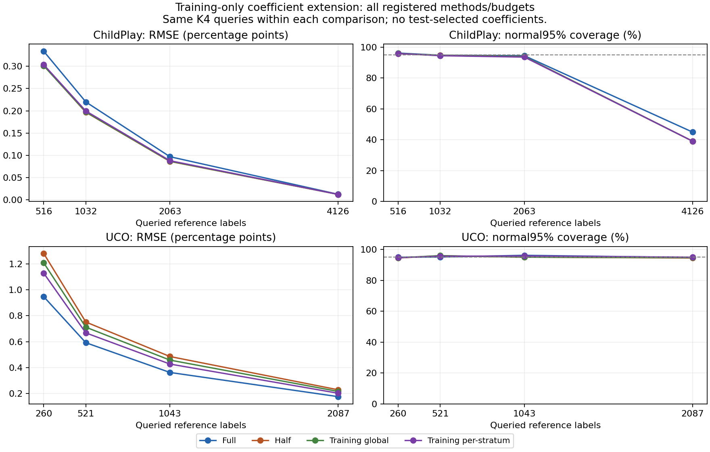

# U: final training-only coefficient experiment

This was the user's last authorized experiment. The recurring research
timer is PAUSED; no further experiment is queued. The full course handoff
and recommendation are in [FINAL_PROJECT_HANDOFF.md](FINAL_PROJECT_HANDOFF.md).

The training-only extension improves over full weight on ChildPlay but
does not beat the earlier half-weight result at the primary budget.
On UCO it improves over half weight but still loses to full weight.
It therefore supplies a useful control, not a new best overall method.

## Frozen recipe and training cost

The config/kernel/runner were committed at1f4a9c8 before coefficient
fitting or new test outcomes. Only191956 eligible training rows from40
ChildPlay training sources were supplied to the coefficient fit. Their
IDs and input files are hashed. Training coefficients were saved before
evaluation-population access in this run. No validation, ChildPlay-test
or UCO labels fit or select these coefficients. The source oracle file
contains multiple splits, but only training-selected records enter fitting.

For fixed phi_i=lambda_h*q_i, the audit uses mean(phi) plus weighted
sample residual means. The coefficient is training Cov(y,q)/Var(q),
clipped to[0,1], with the registered small-count/variance fallback to0.
Strata, K4 allocations, exact query streams and label budgets are frozen.
The global ablation fits the same coefficient on all training rows.
This is an established control-variate idea applied to the course system,
not a claim of a new theorem. Training labels are additional data costs,
even though they reuse existing files; no annotation-free/cold-start
cost advantage over a method without training labels is established.

Global fitted coefficient: 0.574913999803.

| Stratum | Training rows | Fitted coefficient |
|---|---:|---:|
| 0 | 48118 | 0.000000000000 |
| 1 | 47883 | 0.000000000000 |
| 2 | 47977 | 0.045373813914 |
| 3 | 47978 | 0.666164310929 |

## Prespecified primary comparisons

Intervals below are paired draw-bootstrap95% intervals over1000 saved
audits on a fixed corpus, with2000 resamples. They do not quantify
future-domain performance or adjust for the broader exploratory history.

| Corpus | Labels | Per-stratum/full RMSE ratio | Bootstrap interval |
|---|---:|---:|---|
| ChildPlay | 1032 | 0.907451 | [0.891247, 0.924487] |
| UCO | 521 | 1.127822 | [1.096074, 1.161932] |

ChildPlay primary per-stratum RMSE is0.199534pp versus0.219884 full
and0.196725 half. UCO primary per-stratum RMSE is0.668021pp versus
0.592311 full and0.751927 half. ChildPlay per-stratum/half ratio is
1.014277 [1.004207,1.024598], a loss to the prior half-weight choice.
UCO per-stratum/half ratio0.888411 [0.878051,0.898796] improves on that
weaker control, while the primary full-weight comparison still loses.
Both comparisons are retained; no test outcomes choose a final weight.

## All registered method/budget cells

Bias, RMSE and width use percentage points. Coverage uses percent.
Exact design variance uses squared proportions and is analytical for
this fixed population/design. It need not equal finite-draw sample MSE.

| Corpus | Labels | Method | Bias pp | RMSE pp | Normal coverage % | Normal width pp | Exact variance |
|---|---:|---|---:|---:|---:|---:|---:|
| ChildPlay | 516 | full | 0.012363 | 0.333759 | 96.20 | 1.372773 | 1.249173148e-05 |
| ChildPlay | 516 | half | 0.012048 | 0.301458 | 95.80 | 1.216330 | 9.847114432e-06 |
| ChildPlay | 516 | global | 0.012095 | 0.301240 | 96.00 | 1.220211 | 9.911370087e-06 |
| ChildPlay | 516 | stratum | 0.011873 | 0.303541 | 95.90 | 1.234267 | 1.014322031e-05 |
| ChildPlay | 1032 | full | 0.004758 | 0.219884 | 94.80 | 0.841561 | 4.664952816e-06 |
| ChildPlay | 1032 | half | 0.006727 | 0.196725 | 94.70 | 0.746178 | 3.687675280e-06 |
| ChildPlay | 1032 | global | 0.006432 | 0.197369 | 94.60 | 0.748668 | 3.711524621e-06 |
| ChildPlay | 1032 | stratum | 0.006352 | 0.199534 | 94.50 | 0.757286 | 3.796786991e-06 |
| ChildPlay | 2063 | full | 0.004374 | 0.096858 | 94.50 | 0.364497 | 8.763450204e-07 |
| ChildPlay | 2063 | half | 0.003817 | 0.086304 | 93.90 | 0.325586 | 7.062666316e-07 |
| ChildPlay | 2063 | global | 0.003900 | 0.086751 | 93.90 | 0.326631 | 7.105551739e-07 |
| ChildPlay | 2063 | stratum | 0.003930 | 0.087889 | 93.60 | 0.329939 | 7.248479550e-07 |
| ChildPlay | 4126 | full | 0.000197 | 0.012371 | 45.00 | 0.036784 | 1.526645331e-08 |
| ChildPlay | 4126 | half | 0.000133 | 0.012189 | 39.10 | 0.033276 | 1.482726916e-08 |
| ChildPlay | 4126 | global | 0.000143 | 0.012205 | 39.10 | 0.033791 | 1.486634840e-08 |
| ChildPlay | 4126 | stratum | 0.000075 | 0.012178 | 39.10 | 0.030226 | 1.479208972e-08 |
| UCO | 260 | full | 0.012491 | 0.947330 | 95.00 | 3.784929 | 9.356017612e-05 |
| UCO | 260 | half | 0.033339 | 1.280219 | 94.50 | 4.946176 | 1.592171640e-04 |
| UCO | 260 | global | 0.030215 | 1.208035 | 94.60 | 4.680392 | 1.425863314e-04 |
| UCO | 260 | stratum | 0.027049 | 1.128626 | 94.70 | 4.390718 | 1.255273292e-04 |
| UCO | 521 | full | 0.019422 | 0.592311 | 95.10 | 2.368660 | 3.654972711e-05 |
| UCO | 521 | half | 0.014586 | 0.751927 | 95.90 | 3.089771 | 6.212637850e-05 |
| UCO | 521 | global | 0.015310 | 0.712047 | 96.00 | 2.923994 | 5.564237431e-05 |
| UCO | 521 | stratum | 0.015383 | 0.668021 | 95.60 | 2.742941 | 4.897088953e-05 |
| UCO | 1043 | full | 0.008316 | 0.362877 | 96.20 | 1.454106 | 1.375587247e-05 |
| UCO | 1043 | half | 0.008957 | 0.485805 | 95.00 | 1.895055 | 2.336945202e-05 |
| UCO | 1043 | global | 0.008861 | 0.458259 | 95.00 | 1.793509 | 2.093134607e-05 |
| UCO | 1043 | stratum | 0.008507 | 0.427728 | 95.80 | 1.682483 | 1.841920824e-05 |
| UCO | 2087 | full | 0.006310 | 0.176287 | 94.80 | 0.696931 | 3.160120231e-06 |
| UCO | 2087 | half | 0.014260 | 0.229096 | 94.50 | 0.907132 | 5.354504990e-06 |
| UCO | 2087 | global | 0.013069 | 0.216454 | 94.70 | 0.858618 | 4.796915921e-06 |
| UCO | 2087 | stratum | 0.011710 | 0.202588 | 95.00 | 0.805191 | 4.218382854e-06 |

## Every registered paired comparison

A ratio below1 favors the numerator. All losses and ties remain.

| Corpus | Labels | Comparison | RMSE ratio | Paired95% interval |
|---|---:|---|---:|---|
| ChildPlay | 516 | stratum/full | 0.909460 | [0.891634, 0.927346] |
| ChildPlay | 516 | stratum/half | 1.006910 | [0.996245, 1.018022] |
| ChildPlay | 516 | global/full | 0.902568 | [0.879810, 0.925257] |
| ChildPlay | 1032 | stratum/full | 0.907451 | [0.891247, 0.924487] |
| ChildPlay | 1032 | stratum/half | 1.014277 | [1.004207, 1.024598] |
| ChildPlay | 1032 | global/full | 0.897605 | [0.877118, 0.918773] |
| ChildPlay | 2063 | stratum/full | 0.907400 | [0.891657, 0.923945] |
| ChildPlay | 2063 | stratum/half | 1.018361 | [1.008568, 1.027410] |
| ChildPlay | 2063 | global/full | 0.895660 | [0.876988, 0.915325] |
| ChildPlay | 4126 | stratum/full | 0.984385 | [0.970929, 0.997845] |
| ChildPlay | 4126 | stratum/half | 0.999051 | [0.992289, 1.005785] |
| ChildPlay | 4126 | global/full | 0.986617 | [0.980747, 0.992482] |
| UCO | 260 | stratum/full | 1.191375 | [1.161240, 1.223150] |
| UCO | 260 | stratum/half | 0.881588 | [0.873252, 0.890323] |
| UCO | 260 | global/full | 1.275199 | [1.237584, 1.315362] |
| UCO | 521 | stratum/full | 1.127822 | [1.096074, 1.161932] |
| UCO | 521 | stratum/half | 0.888411 | [0.878051, 0.898796] |
| UCO | 521 | global/full | 1.202152 | [1.162051, 1.244968] |
| UCO | 1043 | stratum/full | 1.178713 | [1.146776, 1.210098] |
| UCO | 1043 | stratum/half | 0.880450 | [0.871705, 0.889380] |
| UCO | 1043 | global/full | 1.262849 | [1.222831, 1.302919] |
| UCO | 2087 | stratum/full | 1.149196 | [1.116806, 1.184035] |
| UCO | 2087 | stratum/half | 0.884291 | [0.874497, 0.893957] |
| UCO | 2087 | global/full | 1.227851 | [1.185632, 1.271615] |

## Validation and evidence

Before fitting, exhaustive enumeration of two small stratified designs
checked unbiasedness, exact variance and mean sample variance, including
census. Four coefficient boundary/fallback cases passed. Maximum moment
error5.56e-17. The exact training rows/sources matched the protocol.

All16 full/half budget controls (16000 method/draw cases) reproduced
accepted points, variances and both normal endpoints. Binary-reference
intervals were recomputed on8000 distinct fixed query plans and checked
against accepted full/half endpoints. They are identical for all phi
choices because references and queries are unchanged; they do not
validate the newly weighted normal intervals.

Independent validation recomputed all five coefficient fits with fsum
centered cross-products, all32000 point/variance/normal calculations,
all exact design variances and summary fields, query RNG/label costs,
and all24 bootstrap comparisons. Bootstrap validation used frequency
weights and manually interpolated sorted quantiles rather than the
primary index-mean/np.quantile path. Maximum differences: point1.67e-16,
variance1.00e-16, bootstrap endpoint4.00e-15. A formatting-only literal
split after replay preserved the validator's exact parsed AST. Ruff passes.

All376 prior manifest entries and the main result/policy hashes
remain intact. Input hashes match registration. All32 cells and24
comparisons are saved; the complete figure was visually inspected for
readable budgets, methods, units and the coverage reference. No scientific
stage failed; development lint corrections did not change the method.

## Limits and stopping decision

The cohorts were repeatedly inspected before U was proposed; no fresh
held-out or universal improvement is claimed. Training residual variance
minimization does not guarantee transfer performance. The primary methods
still differ by corpus, and the ChildPlay high-budget normal coverage
failure remains visible. We do not clip points into binary intervals or
replace previously failing error bars. Source/crop/pretraining limits,
missing media, annotation uncertainty and absence of clinical validation
remain as described in the course guide and earlier addenda.

Stop experiments here as requested. The project is sufficiently developed
for a course submission; further parameter search on these labels is
unlikely to strengthen its evidential claims. Prepare the report, slides
and demonstration using the checked guide plus T/U addenda. No new run
or timer is queued. The existing demos/services remain unchanged.

Reproduction commands (a new versioned output/config is required for
another run; the original runner refuses to overwrite evidence):

```powershell
.venv/Scripts/python.exe scripts/run_stratum_weights.py
.venv/Scripts/python.exe scripts/validate_stratum_weights.py
.venv-mtgs/Scripts/python.exe scripts/report_stratum_weights.py
```


