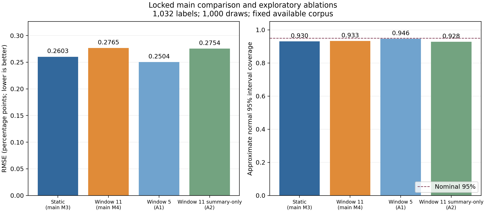

# Course-project results assessment — 7 November 2026

**Subsequent strengthening round:** the additional score/entropy controls,
coverage diagnostics, exact binary reference and interactive demonstration are
complete. See the [new report](../../reports/course-project/strengthening-report.md).
The original main results below remain unchanged; score quartiles outperform
learned guidance at the primary budget in the exploratory extension.

**The completed main experiment is substantial enough for a course project.**
It demonstrates useful label-count efficiency from error-guided sampling on the
verified ChildPlay subset, supported by reproducible controls and validation.
The proposed temporal extension did not improve the locked primary comparison.
That negative result belongs in the presentation; a new statistical method or
general temporal advantage has not been established.

Main run: `outputs/experiments/course-20261107-v1`. The
[shareable report and figures](../../reports/course-project/course-report.md),
[aggregate results](main-course-results.json),
[independent validation](main-course-independent-validation.json) and
[visual review](main-course-visual-review.json) are saved. Both registered
interpretation ablations are complete, independently checked and summarized below.

## What was built and checked

All 95 original public sources were attempted. The frozen media-available
population retains 53 sources: 40 training, 3 validation and 10 test. Eligible
pair-frame counts are 191,956 / 25,139 / 10,316. Unavailable sources and unresolved
alignment failures remain excluded; unknown gaze references never become negatives.
The final merged cache contains 314,058 public pair predictions, including
unknown-reference neighbors used only for public temporal context.

One frozen released MTGS-DINO temporal predictor supplies every method's scores.
Static means current-frame error features; it does not mean a different backbone.
Source-grouped cross-fitting on training labels defines residual strata and
centered residual SD estimates. Validation selects allocation alpha and temporal
window. Test queries are saved before their reference values are revealed.
The common residual-correction estimator and exact budgets isolate the effect
of guidance; M5 checks contextual surrogate refinement with uniform queries.

The main evaluation contains 1,000 draws for each of five sampled methods at
four budgets: **20,000 audits**. Independent code replayed all random query
streams and recomputed all estimates, finite-population variances and RMSE
summaries. All passed; maximum numerical differences were 1.11e-16 for points
and 6.03e-17 for variances. Five report figures and the public replay timeline
were viewed and checked. The replay reproduces the saved M4 draw exactly.

## Main findings

RMSE is in percentage points; smaller is better. Exact budgets are equal across
methods within each column.

| Method | 516 labels | 1,032 labels (primary) | 2,063 labels | 4,126 labels |
| --- | ---: | ---: | ---: | ---: |
| M1 uniform human labels | 0.7784 | 0.5545 | 0.3684 | 0.2168 |
| M2 uniform residual correction | 0.7606 | 0.5529 | 0.3607 | 0.2230 |
| M3 static-guided correction | 0.3950 | **0.2603** | 0.1396 | 0.0019 |
| M4 temporal-guided correction | 0.4351 | **0.2765** | 0.1580 | 0.0227 |
| M5 contextual surrogate, uniform correction | 0.6899 | 0.5047 | 0.3300 | 0.2042 |

The fixed test reference prevalence is 3.5188%; the uncorrected model mean is
7.1412%, a +3.6224 pp error. Uniform use of the original model barely improves
on uniform human estimation at the primary budget and loses at 40%. Guided
allocation is the useful component observed here: M3 lowers primary RMSE by
52.9% and M4 by 50.0% relative to M2. M4 also beats the contextual-surrogate
control at that budget, so surrogate refinement alone does not explain its gain.

The locked primary M4/M3 RMSE ratio is **1.0623**, with paired-draw Monte Carlo
95% interval **[0.9889, 1.1421]**. The temporal method has 6.2% higher observed
error; the interval includes a tie. Leave-one-source-out domain diagnostics also
retain this direction. These are fixed-corpus sensitivity checks under the
original query design, with removed-source queries still charged.

At 40%, M3's tiny RMSE is a finite-population saturation effect: its census strata
contain all 363 test positives, and the remaining sampled stratum has very small
residual variance. The post-hoc [census explanation](main-census-explanation.json)
gives an exact design RMSE of 0.001865 pp, consistent with the observed 0.001887.
This diagnostic explains an existing result; it selected no policy. It does not
imply that a 40% sample will nearly solve a new dataset.

Post-hoc training feature importances are dominated by score/entropy features.
They are descriptive and do not establish necessity or causation. The later B1
extension evaluates score/entropy controls; score quartiles beat the learned
policy at 5–20%. Alternative learners remain deferred. These results do not show
that a learned policy is better than simpler allocation rules.

## Interval limitations

At 10%, approximate normal 95% coverage is 94.2% / 94.7% / **93.0% / 93.3%** /
94.4% for M1–M5. M3/M4 mean normal widths are 0.9911 / 1.0560 pp. At 20%, their
coverage falls further to 91.3% / 90.5%. The implementation checks pass, but
normal intervals under-cover in these simulated audits. Report width alongside
coverage; narrower intervals alone do not establish reliable uncertainty.
The bounded-residual reference covers all draws but is very wide (about 27 pp
for guided methods at 10%). No failed, zero-positive or zero-variance draw was
observed in the main sampled grid.

## A1: registered window comparison

Both existing window models select alpha 1 using their saved validation outcomes.
At B=1,032 and 1,000 draws each, window 5 has RMSE **0.2504 pp** and window 11
**0.2765 pp**. W11/W5 is **1.1045 [1.0388, 1.1738]**. Normal coverage is 94.6%
for W5 and 93.3% for W11; mean widths are 0.9671 / 1.0560 pp. Bias is about
+0.0053 pp for each. There are no observed failed, zero-positive or zero-variance draws.
All 2,000 follow-up draws passed independent RNG/point/variance checks; W11
reproduces all corresponding main M4 queries and estimates.

The W5/static ratio is **0.9618 [0.8983, 1.0275]**, so a temporal advantage over
static remains uncertain. This comparison was registered after the main outcomes
and shares the test corpus: it is an exploratory interpretation, not independent
confirmation. The validation-selected main window remains 11. Full endpoints,
including bounded intervals, are in [A1 results](followup-A1-results.json).

## A2: summaries without transition/boundary features

The registered summary-only ablation completed in 547.9 seconds, CPU only, in
`outputs/experiments/followups-20261107/A2-summary-only-v1`. It removed exactly
eight registered columns and refitted the original training recipe; validation
selected alpha 1. At B=1,032 its 1,000 test draws have RMSE **0.2754 pp**, bias
+0.0061 pp, normal coverage **92.8%** and mean normal width 1.0307 pp. Bounded
coverage is 100%, with a very wide mean width of 28.3285 pp. There were no failed,
zero-positive or zero-variance draws.

Summary-only/full-temporal RMSE is **0.9960 [0.9454, 1.0478]**; summary-only/static
is **1.0580 [0.9843, 1.1362]**. Removing the ordered transition/boundary features
barely changes error, and both intervals include a tie. These checks provide no
clear evidence of added value from those eight features. They do not isolate all
forms of temporal order or establish that temporal information is never useful.

All 1,000 draws passed independent RNG/point/variance checks. A separate
[integrity check](followup-A2-integrity.json) verified model settings, the exact
feature removal, query hashes and unchanged main result/policy hashes. The
[registration](followup-A2-registration.json),
[validation selection and feature list](followup-A2-policy-lock.json), and
[complete outcomes](followup-A2-results.json) are retained. Original registration,
policy and main-result files were not edited after observing follow-up outcomes.

All required experiments and these two registered follow-ups are finished.
The final plot was visually checked. The later user-authorized B1/B2/B2b/B3 round
is reported separately; remaining optional experiments are deferred. There are 20,000 main
and 3,000 follow-up evaluations, including 1,000 exact main-M4 reproductions in A1.

## Claims and costs appropriate for the course

Present this as **a reproducible evaluation of error-guided annotation for
mutual-looking prevalence**, with an explicit test of whether extra temporal
features help. The contribution is the working cache-to-audit pipeline, verified
media mapping, exact budgets, label isolation, controls, replay and honest
comparison. Residual correction and stratification are established methods.

Historical references reused for development number 191,956 training and 25,139
validation labels. These are separate from test audit budgets; this is not a
cold-start annotation-cost result. The two inference batches took about 3.76
local GPU hours in total, including one subsequently excluded source. Main policy
development took about 31.5 minutes; main sampled evaluation about 4.0 minutes.
No Kaggle GPU quota was used. [Cost ledger](../../reports/course-project/cost-ledger.json).
No annotator time was measured, so human-time savings are not demonstrated.

Limit conclusions to the available media and benchmark labels with provided
head tracks. Media alignment was visually reviewed; pixelwise equivalence to
the original released images is not established. Three validation sources limit
selection stability. Earlier test
reference inspection makes the study exploratory. The pretrained predictor may
have seen the original benchmark training sources. Monte Carlo intervals measure
sampling variability on this fixed corpus, not transfer to unseen sources.
This does not validate ADHD diagnosis, clinical screening, direct eye contact
measurement or a fully automatic system operating on arbitrary raw videos.

Evidence integrity and file hashes: [manifest](course-evidence-manifest.json).
Reproduction commands: [RUN_EXPERIMENTS.md](../RUN_EXPERIMENTS.md).
