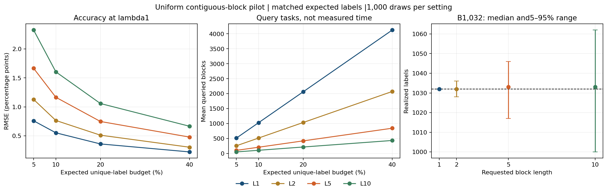

# Contiguous-block pilot G1

The primary L5/L1 RMSE ratio at B1032 and lambda1 is 2.1089, with fixed-corpus draw-bootstrap range[1.9781788619227185, 2.2382313830075202]. All outcomes use equal expected unique-label cost; realized cost varies. This is a uniform-block pilot, not the queued static-versus-temporal guidance comparison.

| Split | L | Eligible frames | Blocks | Mean size | Partial-block rate |
| --- | ---: | ---: | ---: | ---: | ---: |
| train | 1 | 191956 | 191956 | 1.000 | 0.000 |
| train | 2 | 191956 | 97142 | 1.976 | 0.024 |
| train | 5 | 191956 | 40347 | 4.758 | 0.090 |
| train | 10 | 191956 | 21524 | 8.918 | 0.186 |
| validation | 1 | 25139 | 25139 | 1.000 | 0.000 |
| validation | 2 | 25139 | 12726 | 1.975 | 0.025 |
| validation | 5 | 25139 | 5275 | 4.766 | 0.083 |
| validation | 10 | 25139 | 2815 | 8.930 | 0.170 |
| test | 1 | 10316 | 10316 | 1.000 | 0.000 |
| test | 2 | 10316 | 5186 | 1.989 | 0.011 |
| test | 5 | 10316 | 2116 | 4.875 | 0.049 |
| test | 10 | 10316 | 1092 | 9.447 | 0.100 |

| L | Weight | Expected B | RMSE pp | Exact design RMSE pp | Normal coverage | Mean labels | Label5–95% | Over B rate | Mean blocks |
| ---: | ---: | ---: | ---: | ---: | ---: | ---: | --- | ---: | ---: |
| 1 | 1 | 516 | 0.7606 | 0.7902 | 0.959 | 516.00 | [516,516] | 0.000 | 516.00 |
| 1 | 1 | 1032 | 0.5529 | 0.5439 | 0.947 | 1032.00 | [1032,1032] | 0.000 | 1032.00 |
| 1 | 1 | 2063 | 0.3607 | 0.3627 | 0.954 | 2063.00 | [2063,2063] | 0.000 | 2063.00 |
| 1 | 1 | 4126 | 0.2230 | 0.2221 | 0.947 | 4126.00 | [4126,4126] | 0.000 | 4126.00 |
| 1 | 0.5 | 516 | 0.6248 | 0.6494 | 0.950 | 516.00 | [516,516] | 0.000 | 516.00 |
| 1 | 0.5 | 1032 | 0.4622 | 0.4469 | 0.943 | 1032.00 | [1032,1032] | 0.000 | 1032.00 |
| 1 | 0.5 | 2063 | 0.2990 | 0.2980 | 0.960 | 2063.00 | [2063,2063] | 0.000 | 2063.00 |
| 1 | 0.5 | 4126 | 0.1814 | 0.1825 | 0.949 | 4126.00 | [4126,4126] | 0.000 | 4126.00 |
| 2 | 1 | 516 | 1.1293 | 1.1062 | 0.945 | 516.10 | [513,519] | 0.416 | 259.40 |
| 2 | 1 | 1032 | 0.7657 | 0.7614 | 0.947 | 1032.03 | [1028,1036] | 0.441 | 518.79 |
| 2 | 1 | 2063 | 0.5119 | 0.5077 | 0.948 | 2063.08 | [2057,2068] | 0.464 | 1037.10 |
| 2 | 1 | 4126 | 0.3042 | 0.3109 | 0.949 | 4126.10 | [4120,4132] | 0.462 | 2074.20 |
| 2 | 0.5 | 516 | 0.9236 | 0.9108 | 0.943 | 516.10 | [513,519] | 0.416 | 259.40 |
| 2 | 0.5 | 1032 | 0.6398 | 0.6268 | 0.939 | 1032.03 | [1028,1036] | 0.441 | 518.79 |
| 2 | 0.5 | 2063 | 0.4053 | 0.4180 | 0.956 | 2063.08 | [2057,2068] | 0.464 | 1037.10 |
| 2 | 0.5 | 4126 | 0.2534 | 0.2560 | 0.956 | 4126.10 | [4120,4132] | 0.462 | 2074.20 |
| 5 | 1 | 516 | 1.6668 | 1.7084 | 0.946 | 515.91 | [504,525] | 0.524 | 105.83 |
| 5 | 1 | 1032 | 1.1660 | 1.1758 | 0.942 | 1032.28 | [1017,1046] | 0.507 | 211.69 |
| 5 | 1 | 2063 | 0.7484 | 0.7841 | 0.954 | 2063.69 | [2046,2081] | 0.533 | 423.17 |
| 5 | 1 | 4126 | 0.4790 | 0.4802 | 0.950 | 4126.38 | [4104,4148] | 0.491 | 846.30 |
| 5 | 0.5 | 516 | 1.3593 | 1.4041 | 0.935 | 515.91 | [504,525] | 0.524 | 105.83 |
| 5 | 0.5 | 1032 | 0.9727 | 0.9664 | 0.948 | 1032.28 | [1017,1046] | 0.507 | 211.69 |
| 5 | 0.5 | 2063 | 0.6323 | 0.6444 | 0.950 | 2063.69 | [2046,2081] | 0.533 | 423.17 |
| 5 | 0.5 | 4126 | 0.3887 | 0.3946 | 0.947 | 4126.38 | [4104,4148] | 0.491 | 846.30 |
| 10 | 1 | 516 | 2.3271 | 2.3452 | 0.914 | 515.65 | [490,537] | 0.496 | 54.59 |
| 10 | 1 | 1032 | 1.6047 | 1.6140 | 0.951 | 1032.40 | [1000,1062] | 0.523 | 109.25 |
| 10 | 1 | 2063 | 1.0584 | 1.0763 | 0.949 | 2064.00 | [2022,2106] | 0.521 | 218.40 |
| 10 | 1 | 4126 | 0.6661 | 0.6591 | 0.947 | 4126.52 | [4078,4175] | 0.505 | 436.77 |
| 10 | 0.5 | 516 | 1.9559 | 1.9301 | 0.854 | 515.65 | [490,537] | 0.496 | 54.59 |
| 10 | 0.5 | 1032 | 1.3230 | 1.3283 | 0.926 | 1032.40 | [1000,1062] | 0.523 | 109.25 |
| 10 | 0.5 | 2063 | 0.8921 | 0.8858 | 0.939 | 2064.00 | [2022,2106] | 0.521 | 218.40 |
| 10 | 0.5 | 4126 | 0.5337 | 0.5424 | 0.954 | 4126.52 | [4078,4175] | 0.505 | 436.77 |

Longer contiguous queries reduce the number of query tasks but can increase residual correlation and estimation error. Query-task count is not measured human effort or speed. These results do not justify a time-saving claim. The variance estimator is conditional on the randomized block count; averaging its unbiased conditional variance is appropriate because each conditional point estimator has the same population expectation.

The transferred weight0.5 uses the earlier uniform validation choice and is not retuned for blocks. Every setting and cost tail is retained. Length1 lambda1 reproduces the original M2 queries/estimates exactly. No new GPU inference or risk-model fitting was used. No valid exact binary interval is claimed for nonbinary block residual totals.

All32,000 method-draw estimates passed independent RNG/point/variance checks in the runner, and saved-output summaries/costs and the primary bootstrap were checked separately. Next is G2 registration using frozen per-frame static/temporal OOF score aggregates; G1 does not select its length on test.

Protocol: docs/X01_BLOCK_PILOT_G.md. Run scripts/run_block_pilot.py in the CPU environment and scripts/report_block_pilot.py in the plotting environment. Existing numerical roots refuse overwrite; reruns need a versioned config/output.
