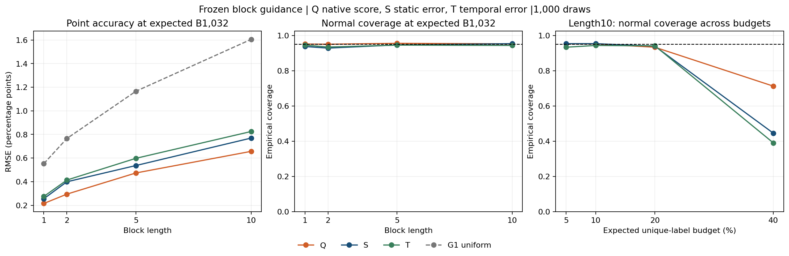

# G2: frozen-score block guidance

Primary T/S RMSE ratio at L5/B1032: 1.113855 (11.39% higher error), Monte Carlo95% range [1.0388955580490669, 1.2033875959701925]. The registered descriptive10% gain threshold is not met. No temporal improvement is claimed. All point estimates use lambda1.

Q uses native q block sums; S/T use sums of frozen static/temporal signed-error scores, with source-OOF scores for training cuts. No new model was fitted. All lengths and policies were fixed before outcomes; alpha was selected on validation only. The repeatedly inspected test corpus remains exploratory.

| Length/policy | Validation-selected alpha |
| --- | ---: |
| L1-Q | 1.0 |
| L1-S | 1.0 |
| L1-T | 1.0 |
| L2-Q | 1.0 |
| L2-S | 1.0 |
| L2-T | 1.0 |
| L5-Q | 1.0 |
| L5-S | 1.0 |
| L5-T | 1.0 |
| L10-Q | 1.0 |
| L10-S | 1.0 |
| L10-T | 1.0 |

| L | Policy | Expected B | RMSE pp | Bias pp | Mean labels | Label5–95% | Mean blocks | Normal coverage | Bounded coverage | Bounded width pp |
| ---: | --- | ---: | ---: | ---: | ---: | --- | ---: | ---: | ---: | ---: |
| 1 | Q | 516 | 0.3574 | -0.0268 | 516.03 | [515,517] | 516.03 | 0.937 | 1.000 | 35.333 |
| 1 | Q | 1032 | 0.2158 | -0.0069 | 1032.02 | [1031,1033] | 1032.02 | 0.952 | 1.000 | 26.018 |
| 1 | Q | 2063 | 0.0946 | 0.0017 | 2063.02 | [2062,2064] | 2063.02 | 0.947 | 1.000 | 19.435 |
| 1 | Q | 4126 | 0.0123 | 0.0003 | 4126.02 | [4125,4127] | 4126.02 | 0.448 | 1.000 | 9.706 |
| 1 | S | 516 | 0.3972 | 0.0056 | 515.97 | [515,517] | 515.97 | 0.931 | 1.000 | 37.559 |
| 1 | S | 1032 | 0.2560 | -0.0023 | 1031.97 | [1031,1033] | 1031.97 | 0.938 | 1.000 | 27.623 |
| 1 | S | 2063 | 0.1322 | -0.0006 | 2063.00 | [2062,2064] | 2063.00 | 0.922 | 1.000 | 20.571 |
| 1 | S | 4126 | 0.0019 | -0.0000 | 4126.00 | [4126,4126] | 4126.00 | 0.940 | 1.000 | 6.626 |
| 1 | T | 516 | 0.4245 | -0.0062 | 516.02 | [515,517] | 516.02 | 0.943 | 1.000 | 36.607 |
| 1 | T | 1032 | 0.2752 | -0.0031 | 1031.99 | [1031,1033] | 1031.99 | 0.946 | 1.000 | 27.014 |
| 1 | T | 2063 | 0.1532 | 0.0056 | 2063.00 | [2062,2064] | 2063.00 | 0.926 | 1.000 | 20.140 |
| 1 | T | 4126 | 0.0218 | -0.0015 | 4125.99 | [4125,4127] | 4125.99 | 0.951 | 1.000 | 9.024 |
| 2 | Q | 516 | 0.4593 | -0.0050 | 515.83 | [512,520] | 259.92 | 0.958 | 1.000 | 45.619 |
| 2 | Q | 1032 | 0.2947 | -0.0072 | 1031.93 | [1028,1036] | 519.96 | 0.951 | 1.000 | 33.167 |
| 2 | Q | 2063 | 0.1320 | -0.0024 | 2062.93 | [2058,2068] | 1039.39 | 0.938 | 1.000 | 24.483 |
| 2 | Q | 4126 | 0.0143 | -0.0001 | 4126.00 | [4122,4130] | 2076.02 | 0.639 | 1.000 | 11.606 |
| 2 | S | 516 | 0.5965 | -0.0453 | 516.03 | [513,520] | 260.79 | 0.956 | 1.000 | 48.552 |
| 2 | S | 1032 | 0.3993 | -0.0017 | 1031.96 | [1028,1037] | 521.36 | 0.929 | 1.000 | 35.427 |
| 2 | S | 2063 | 0.2190 | -0.0045 | 2063.12 | [2059,2067] | 1042.21 | 0.873 | 1.000 | 26.076 |
| 2 | S | 4126 | 0.0237 | -0.0008 | 4126.10 | [4123,4129] | 2090.16 | 0.960 | 1.000 | 9.994 |
| 2 | T | 516 | 0.6593 | -0.0559 | 516.00 | [512,520] | 260.51 | 0.946 | 1.000 | 46.075 |
| 2 | T | 1032 | 0.4139 | -0.0184 | 1031.95 | [1028,1036] | 520.60 | 0.935 | 1.000 | 33.780 |
| 2 | T | 2063 | 0.2248 | 0.0040 | 2062.99 | [2059,2068] | 1040.60 | 0.900 | 1.000 | 24.934 |
| 2 | T | 4126 | 0.0455 | 0.0005 | 4126.06 | [4122,4130] | 2086.68 | 0.934 | 1.000 | 10.989 |
| 5 | Q | 516 | 0.7647 | 0.0028 | 516.28 | [505,527] | 106.03 | 0.942 | 1.000 | 65.919 |
| 5 | Q | 1032 | 0.4741 | 0.0018 | 1032.00 | [1018,1046] | 212.09 | 0.956 | 1.000 | 47.553 |
| 5 | Q | 2063 | 0.2129 | 0.0003 | 2062.48 | [2048,2075] | 423.96 | 0.956 | 1.000 | 34.656 |
| 5 | Q | 4126 | 0.0270 | -0.0005 | 4126.39 | [4110,4143] | 846.55 | 0.494 | 1.000 | 15.392 |
| 5 | S | 516 | 0.9134 | -0.0323 | 515.83 | [504,526] | 107.46 | 0.942 | 1.000 | 68.535 |
| 5 | S | 1032 | 0.5370 | 0.0205 | 1032.23 | [1019,1045] | 214.92 | 0.947 | 1.000 | 49.510 |
| 5 | S | 2063 | 0.3070 | 0.0100 | 2063.03 | [2050,2076] | 429.65 | 0.874 | 1.000 | 36.041 |
| 5 | S | 4126 | 0.0640 | 0.0004 | 4125.55 | [4112,4139] | 871.59 | 0.942 | 1.000 | 13.765 |
| 5 | T | 516 | 0.8779 | -0.0236 | 516.03 | [505,527] | 107.05 | 0.950 | 1.000 | 67.236 |
| 5 | T | 1032 | 0.5981 | -0.0049 | 1032.41 | [1019,1046] | 213.83 | 0.946 | 1.000 | 48.692 |
| 5 | T | 2063 | 0.3076 | -0.0014 | 2063.34 | [2050,2077] | 427.45 | 0.914 | 1.000 | 35.460 |
| 5 | T | 4126 | 0.0800 | -0.0010 | 4126.29 | [4112,4140] | 864.28 | 0.885 | 1.000 | 15.066 |
| 10 | Q | 516 | 1.0586 | 0.0214 | 516.38 | [492,538] | 54.84 | 0.953 | 1.000 | 84.785 |
| 10 | Q | 1032 | 0.6568 | -0.0017 | 1031.70 | [1004,1059] | 109.64 | 0.953 | 1.000 | 64.098 |
| 10 | Q | 2063 | 0.3115 | 0.0017 | 2061.99 | [2032,2091] | 219.23 | 0.934 | 1.000 | 46.248 |
| 10 | Q | 4126 | 0.0311 | 0.0014 | 4124.52 | [4086,4161] | 436.77 | 0.713 | 1.000 | 20.099 |
| 10 | S | 516 | 1.2481 | -0.0025 | 515.35 | [490,538] | 55.99 | 0.954 | 1.000 | 92.833 |
| 10 | S | 1032 | 0.7692 | -0.0087 | 1032.82 | [1004,1061] | 112.01 | 0.954 | 1.000 | 66.252 |
| 10 | S | 2063 | 0.4236 | -0.0102 | 2062.89 | [2035,2090] | 223.84 | 0.940 | 1.000 | 47.889 |
| 10 | S | 4126 | 0.1045 | 0.0028 | 4125.77 | [4099,4153] | 462.91 | 0.446 | 1.000 | 19.976 |
| 10 | T | 516 | 1.2537 | -0.0243 | 516.81 | [492,539] | 55.66 | 0.934 | 1.000 | 89.773 |
| 10 | T | 1032 | 0.8249 | -0.0483 | 1031.28 | [1001,1059] | 110.89 | 0.944 | 1.000 | 64.758 |
| 10 | T | 2063 | 0.4035 | 0.0268 | 2062.63 | [2034,2092] | 221.62 | 0.942 | 1.000 | 46.870 |
| 10 | T | 4126 | 0.1150 | 0.0050 | 4126.62 | [4097,4157] | 449.51 | 0.391 | 1.000 | 20.703 |

## Same-length uniform comparison at primary expected budget

| L | Policy | RMSE ratio to G1 uniform | Draw-bootstrap95% range |
| ---: | --- | ---: | --- |
| 1 | Q | 0.3902 | [0.3675, 0.4165] |
| 1 | S | 0.4629 | [0.4353, 0.4952] |
| 1 | T | 0.4977 | [0.4673, 0.5325] |
| 2 | Q | 0.3849 | [0.3617, 0.4107] |
| 2 | S | 0.5215 | [0.489, 0.5572] |
| 2 | T | 0.5405 | [0.5063, 0.5755] |
| 5 | Q | 0.4066 | [0.3834, 0.4317] |
| 5 | S | 0.4605 | [0.4286, 0.4904] |
| 5 | T | 0.5129 | [0.4759, 0.5489] |
| 10 | Q | 0.4093 | [0.386, 0.4315] |
| 10 | S | 0.4794 | [0.4419, 0.5204] |
| 10 | T | 0.5141 | [0.4769, 0.5525] |

Guidance improves on uniform contiguous-block sampling at the primary budget, but that does not establish an advantage for long blocks over frame queries. Compare each L>1 with its corresponding G2 L1 control using the retained aggregate ratios. Native q remains an essential control against attributing its stratification benefit to a temporal error learner.

Budgets match expected unique-frame labels; random block counts and partial blocks cause actual costs to vary. Minimum2 blocks per noncensus stratum is shared across G2 lengths. G2 L1 differs from the original main exact-budget frame design with minimum20; it does not replace or re-evaluate that main study.

Normal coverage fails severely at some high-budget settings (including L10). The separately reported Hoeffding residual-total reference remains conservative and broad. It is not a binary hypergeometric interval, and neither interval family changes the retained point estimate. No measured annotation-time or unseen-source/clinical generalization claim follows from query-task counts.

All48,000 test evaluations and3,600 validation candidate draws passed separate replay/recomputation, including public geometry, frozen OOF/fitted scores, training moments, alpha selection, FPC variances, bounded endpoints, costs, summaries and112 stored bootstrap comparisons. Additional registered same-length uniform comparisons use the saved G1 draws.

Protocol: docs/X01_BLOCK_GUIDANCE_G2.md. CPU commands: scripts/run_block_guidance.py and scripts/validate_block_guidance.py; plotting environment: scripts/report_block_guidance.py. Existing numerical/verification roots refuse overwrite; reproduction needs a new versioned config/output.
