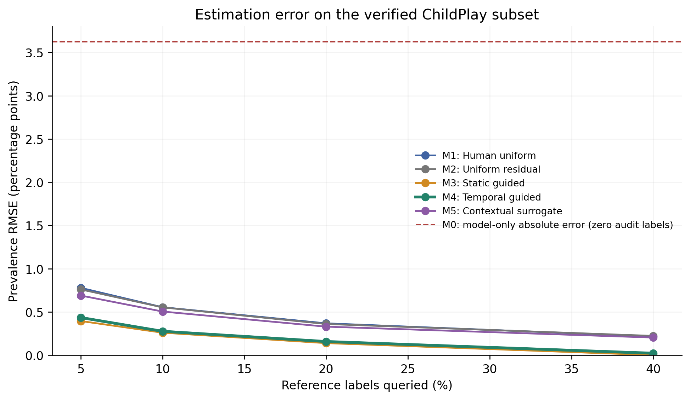
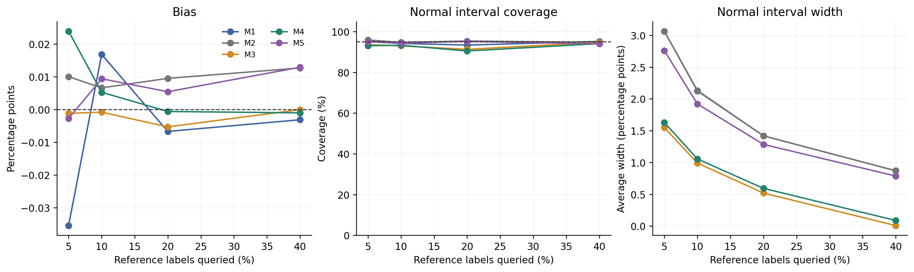
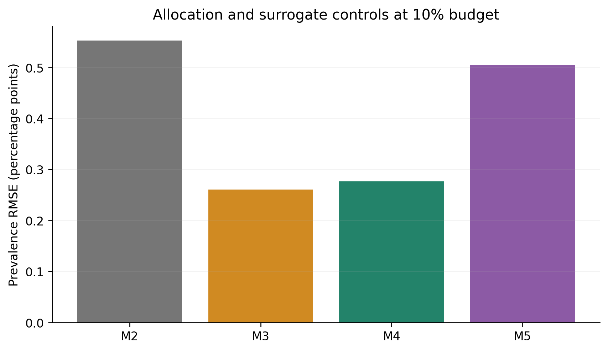
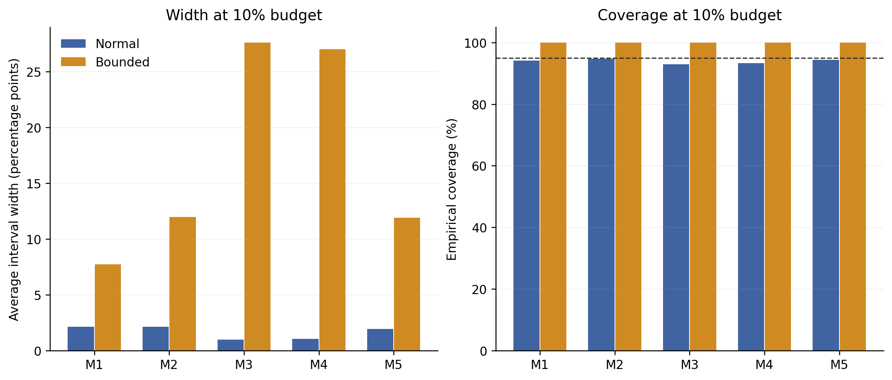
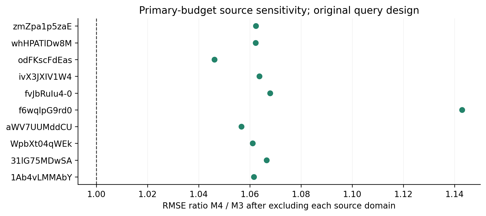
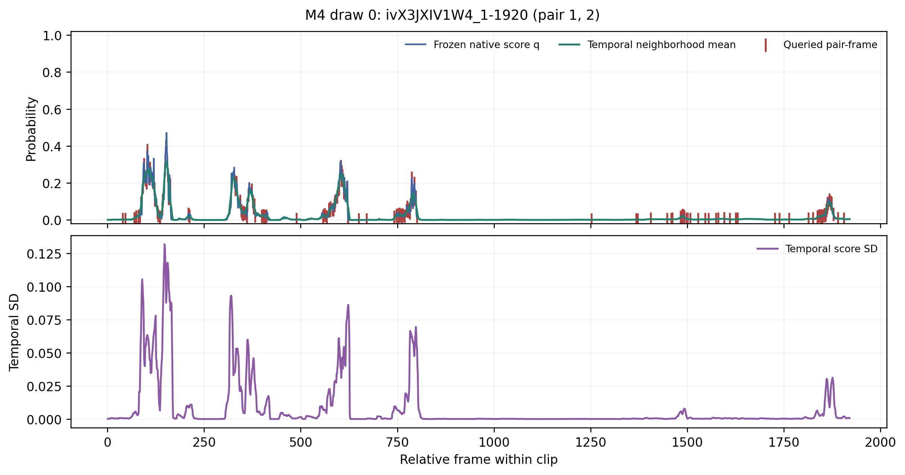
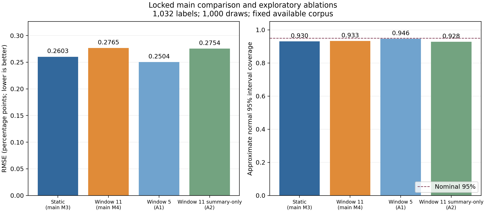

# Temporal error-guided auditing: course experiment report

Subsequent registered extensions add score/entropy controls, coverage diagnostics and a local explorer. Score quartiles beat learned guidance at the primary budget; see the [strengthening report](strengthening-report.md). The locked main results below remain unchanged.

Temporal guidance did not improve the primary RMSE comparison against static guidance.

This is an exploratory, fixed-corpus benchmark. A positive result would be an application result; generic stratification, residual correction and temporal context are established ideas.

## Data and frozen protocol

All 95 original source videos were attempted. The verified subset retains 53 sources and 10,316 eligible test pair-frames from 10 sources. Unknown references are excluded. Failed/changed/challenged media are recorded in the population manifest. The results target this available subset and do not estimate the missing videos' prevalence.

The frozen predictor is the released MTGS-DINO temporal model. Static M3 and temporal M4 share its native q and the same finite-population difference estimator. Training-source cross-fitting defines error strata; validation selects among nine prespecified allocation/window candidates. No predictor weights or policy parameters are fitted to test references.

Selected static alpha: 1.0; temporal alpha: 1.0, window: 11. Each method/budget has 1,000 draws. Query plans were saved before oracle access. M1/M2/M5 reuse the same uniform queries.

Test reference prevalence: 3.5188%. Uncorrected model mean: 7.1412% (bias +3.6224 percentage points).

## Estimation results

| Method | 5% RMSE | 10% RMSE | 20% RMSE | 40% RMSE |
| --- | ---: | ---: | ---: | ---: |
| M1: Human uniform | 0.7784 | 0.5545 | 0.3684 | 0.2168 |
| M2: Uniform residual | 0.7606 | 0.5529 | 0.3607 | 0.2230 |
| M3: Static guided | 0.3950 | 0.2603 | 0.1396 | 0.0019 |
| M4: Temporal guided | 0.4351 | 0.2765 | 0.1580 | 0.0227 |
| M5: Contextual surrogate | 0.6899 | 0.5047 | 0.3300 | 0.2042 |
| M0: Model only (zero labels) | 3.6224 | 3.6224 | 3.6224 | 3.6224 |

RMSE units are percentage points. Exact budgets: 516, 1032, 2063, 4126.

Primary M4/M3 RMSE ratio: 1.0623, with paired-draw bootstrap interval [0.9889, 1.1421]. This interval reflects Monte Carlo uncertainty on the fixed corpus, not transfer to new sources.

M5 uses the same temporal error model to adjust the surrogate, with uniform correction. Its comparison with M4 distinguishes the allocation benefit from a contextual surrogate benefit. All comparisons, including losses and ties, are retained in result.json.

## Intervals and source sensitivity

Normal 95% intervals are approximate. The bounded-residual reference can be much wider; coverage and width must be considered together. M1 additionally has an exact hypergeometric interval. The CSV records sparse-positive, zero-variance and failure rates.

M4 normal interval coverage at the primary budget was 93.3%. An RMSE reduction alone does not establish useful confidence intervals.

Source-domain and leave-source-out-domain estimates under the original full-corpus query design; removed-source queries are still charged. No refitting or new-source guarantee.

## Cost and interpretation limits

Historical development references reused: 191,956 training and 25,139 validation labels. These costs are separate from each test audit's budget. No new annotators were timed; label-count efficiency is not a measured human-time saving.

The official backbone was trained on VSGaze; this study reuses historical training annotations for the error model. It evaluates a frozen published predictor, rather than a cold-start system with a newly purchased development set.

Compute and reference-label costs are itemized in `cost-ledger.json`. GPU preprocessing and inference are shared by all methods; repeated audits reuse the same frozen cache.

Only 3 validation sources remain available, limiting selection stability. Test references had already been inspected in earlier feasibility work, so the experiment is exploratory. Benchmark labels and provided head tracks define the target; this study does not validate ADHD or autism diagnosis, direct eye contact, or fully automatic raw-video deployment.

The contribution suitable for the course is a reproducible temporal-versus-static audit experiment with exact label budgets, query replay, reference isolation, source alignment checks and an explicit contextual-surrogate control. Scientific novelty or general superiority is not established by implementation alone.

## Reproduction artifacts

The estimator uses e_i=y_i-q_i and p_hat=mean_all(q)+sum_h(N_h/M)*mean_sample_h(e). Its estimated variance is sum_h (N_h/M)^2 (1-n_h/N_h) s_e,h^2/n_h. M1 uses q=0; M5 substitutes the frozen contextual surrogate. Fixed partitions and SRS without replacement preserve positive inclusion and exact label counts.

- Evaluation: `outputs\experiments\course-20261107-v1\evaluation`
- Frozen policy lock: `outputs\experiments\course-20261107-v1\development\policy-lock.json`
- Development diagnostics: `outputs\experiments\course-20261107-v1\development-checks\result.json`
- Media/population manifest: `data\raw\childplay\verified-population-v2\population-manifest.json`
- Exported tables: `results-table.csv`; shareable figures: PNG and SVG files in this directory.

## Sources and scope of contribution

- [Official MTGS implementation and model description](https://github.com/idiap/MTGS)
- [VSGaze annotation release](https://zenodo.org/records/17357752)
- [Original ChildPlay release and extraction metadata](https://zenodo.org/records/8252535)
- [Stratified prediction-powered inference](https://proceedings.neurips.cc/paper_files/paper/2024/file/c9fcd02e6445c7dfbad6986abee53d0d-Paper-Conference.pdf)

The temporal predictor is an external pretrained component. The course contribution is the implemented auditing policy, controlled comparison, data-verification workflow and reproducible evidence. This report does not claim to introduce residual correction or stratified sampling as new statistical ideas.

## Final inspection and exploratory follow-ups

All 20,000 sampled audits passed independent replay/recomputation. Five report figures and the query timeline were visually inspected. The tracked [assessment](../../docs/research/course-results.md) records interval undercoverage, the high-budget census explanation and registered follow-up results; it retains the locked main comparison.

## Completed registered interpretation checks

Both exploratory ablations used B=1,032 and 1,000 draws per policy, retaining
all locked main results. Window 5 achieved RMSE 0.2504 pp versus 0.2765 for
window 11; its ratio against static guidance is 0.9618 [0.8983, 1.0275], leaving
an advantage over static uncertain. The summary-only window-11 model achieved
0.2754 pp, with summary-only/full-temporal ratio 0.9960 [0.9454, 1.0478]. The
eight removed transition/boundary features showed no clear benefit here.
All 3,000 follow-up evaluations passed independent replay/recomputation; 1,000
reproduce the existing main M4 draws and are not independent confirmation.
Summary-only normal 95% coverage was 92.8%, retaining the uncertainty limitation.

The [complete assessment](../../docs/research/course-results.md) includes both
exploratory checks, the high-budget census explanation, costs and limitations.
All required experiments and the two registered follow-ups are complete;
optional extensions remain deferred. No additional GPU inference was used.
