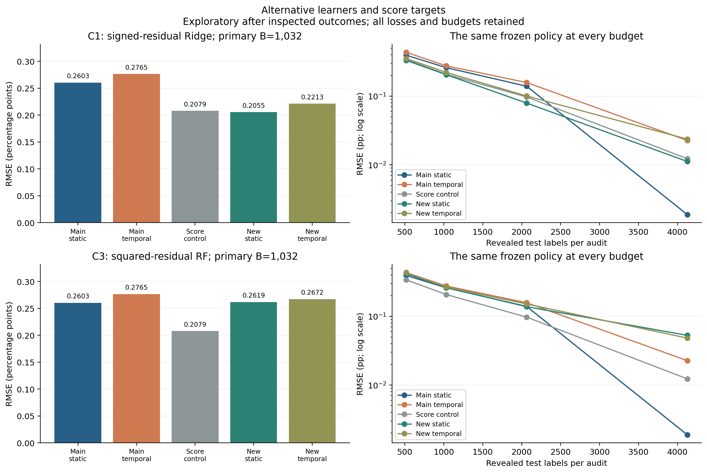
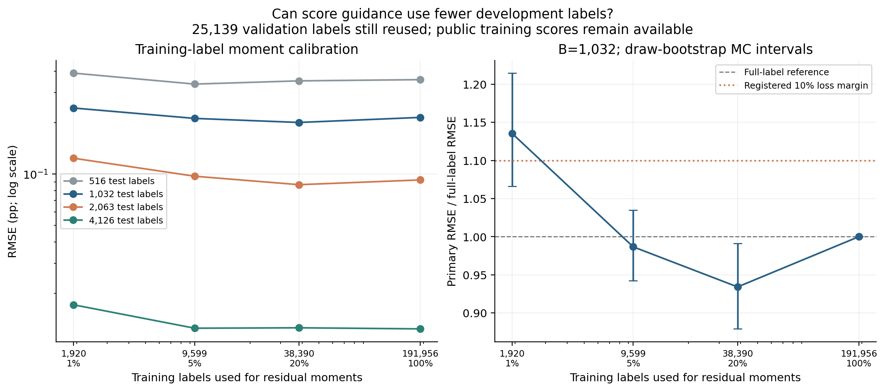
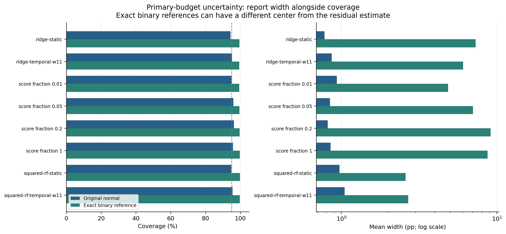

# Additional exploratory results: round C

Registered after the completed course study and strengthening round. This is
an appendix on an already inspected fixed test corpus, not independent
confirmation or a replacement for the locked main comparison. All registered
variants, budgets, losses and uncertainty limitations are retained.

## Recommended use in the course project

Keep the accepted main comparison and add the calibration-label cost curve as
an exploratory result. Five percent of training labels (9,599) gives primary
RMSE 0.2120 pp versus 0.2148 with all 191,956 labels; the ratio is 0.9867
[0.9422,1.0347] on this fixed corpus. The full 25,139 validation labels and
pretrained backbone remain in use. This meets the registered practical cost
signal, but does not prove transfer or real annotation-time savings.

None of the new learned variants meets the registered 10% primary RMSE gain
versus the frozen score control. Ridge-static is approximately tied with it;
the squared-residual RF has worse primary point error. Keep these alternatives
in the appendix rather than recasting a secondary-budget gain as a primary win.

## Alternative learners and score targets

Every method shares frozen MTGS predictions, the eligible population, estimator
and exact annotation budgets. Ridge uses training-fold-only StandardScaler and
fixed alpha=1 regularization. The squared-residual RF changes its score-learning
target; allocation moments remain centered signed-residual SDs. Models use the
original five source folds, validation-only allocation selection and fixed
settings across test budgets.

RMSE (percentage points):

| Method | 516 labels | 1,032 labels | 2,063 labels | 4,126 labels |
| --- | ---: | ---: | ---: | ---: |
| Main learned static | 0.3950 | 0.2603 | 0.1396 | 0.0019 |
| Main learned temporal | 0.4351 | 0.2765 | 0.1580 | 0.0227 |
| Frozen score control | 0.3407 | 0.2079 | 0.0974 | 0.0123 |
| ridge-static | 0.3321 | 0.2055 | 0.0794 | 0.0112 |
| ridge-temporal-w11 | 0.3540 | 0.2213 | 0.1007 | 0.0237 |
| squared-rf-static | 0.4196 | 0.2619 | 0.1382 | 0.0529 |
| squared-rf-temporal-w11 | 0.4327 | 0.2672 | 0.1514 | 0.0482 |

Primary ratios against the frozen score control (Monte Carlo 95% draw-bootstrap intervals):

- ridge-static: 0.9887 [0.9284, 1.0521]. Registered 10% point-improvement threshold met: False.
- ridge-temporal-w11: 1.0647 [0.9971, 1.1328]. Registered 10% point-improvement threshold met: False.
- squared-rf-static: 1.2598 [1.1793, 1.3446]. Registered 10% point-improvement threshold met: False.
- squared-rf-temporal-w11: 1.2856 [1.2011, 1.3699]. Registered 10% point-improvement threshold met: False.

These are descriptive exploratory comparisons without multiplicity-adjusted
discovery claims. A favorable secondary budget is not a new primary endpoint.

## Development-label calibration cost

Public score cut points remain frozen. Training labels were sampled within
source under a deterministic nested permutation before their values were read.
Only the sampled labels estimate residual moments. All variants reuse 25,139
validation labels; this is masking of existing labels, not a real annotation
purchase or a cold-start study. The 100% moments reproduce the B1 policy; a
different registered query stream means its Monte Carlo result need not match B1.
These costs cover downstream audit calibration only: the frozen pretrained
MTGS backbone and its historical supervision remain unchanged and are not
included in the training-plus-validation totals below.

| Fraction | Train labels | Train + validation | RMSE (pp) | Ratio/full and MC interval |
| --- | ---: | ---: | ---: | --- |
| 1% | 1,920 | 27,059 | 0.2439 | 1.1355 [1.0663, 1.2146] |
| 5% | 9,599 | 34,738 | 0.2120 | 0.9867 [0.9422, 1.0347] |
| 20% | 38,390 | 63,529 | 0.2007 | 0.9341 [0.8790, 0.9913] |
| 100% | 191,956 | 217,095 | 0.2148 | 1.0000 [1.0000, 1.0000] |

Non-monotonic results can reflect moment shrinkage, source shift and Monte Carlo variation; fewer labels are not intrinsically more informative. Validation costs must remain in any cost claim.

## Coverage and width

| Policy | Normal coverage, 10% | Binary coverage, 10% | Mean widths (pp) | Normal, 40% |
| --- | ---: | ---: | --- | ---: |
| ridge-static | 94.3% | 99.5% | 0.7784 / 7.3007 | 84.0% |
| ridge-temporal-w11 | 95.2% | 99.4% | 0.8645 / 6.0576 | 74.2% |
| score-labels-0.01 | 94.9% | 99.4% | 0.9328 / 4.8543 | 47.6% |
| score-labels-0.05 | 96.0% | 99.5% | 0.8448 / 7.0139 | 44.9% |
| score-labels-0.2 | 96.3% | 99.6% | 0.8154 / 9.1048 | 44.2% |
| score-labels-1 | 95.8% | 99.7% | 0.8500 / 8.7059 | 44.8% |
| squared-rf-static | 94.8% | 99.8% | 0.9703 / 2.5858 | 87.6% |
| squared-rf-temporal-w11 | 95.5% | 99.7% | 1.0470 / 2.6873 | 93.2% |

The exact binary reference uses only sampled binary successes and fixed stratum
sizes, with Bonferroni-adjusted hypergeometric inversions. It ignores q, can be
wide and is not generally centered on the retained residual point estimate.
Point-outside-reference rates and all bounded interval metrics are retained in
the aggregate JSON. Normal-interval failures are not hidden by reporting only
point-error improvements or primary-budget coverage.

Some secondary-budget failures are severe: squared-RF-static normal coverage
is 79.9% at 20% labels, Ridge-temporal is 74.2% at 40%, and the score cost-curve
variants are around 44-48% at 40%. Low point error does not remove these limits.

There is a secondary width tradeoff: squared-RF-static has a 2.586 pp primary
exact-reference width versus 8.706 pp for the full-label C2 score policy, but
worse point RMSE (0.2619 versus 0.2148 pp). This interval-width observation is
not the registered primary efficacy endpoint or a reason to replace its result.

## Verification, costs and interpretation

All 32,000 new test evaluations and 2,400 validation candidate evaluations were
independently replayed and recomputed, including selection, exact budgets,
finite-population variances, intervals and RMSEs. Source-nested training subsets
were independently reconstructed. Original main/B1 results, policies, source
folds and prediction caches remain unchanged. No further GPU inference or new
human annotation was used.

- C1-ridge: 8,000 test evaluations, 110.2 seconds including fitting, selection and evaluation.
- C2-label-cost: 16,000 test evaluations, 175.8 seconds including fitting, selection and evaluation.
- C3-squared-rf: 8,000 test evaluations, 864.0 seconds including fitting, selection and evaluation.

The existing course submission remains valid whether or not these variants
improve it. Practical signals were registered before this round's outcomes:
10% primary RMSE improvement versus the score control, or a reduced-training-
label calibration within 10% of its own full-label reference. Report uncertainty
and all tradeoffs rather than turning either threshold into a claim of general
superiority. The same inspected corpus, three validation sources, historical
backbone exposure and repeated exploratory comparisons limit inference.

Stop after this registered queue. No additional learner/window search was
launched to rescue a negative outcome. The contribution remains a reproducible
audit-method comparison and cost/uncertainty analysis, not a new gaze backbone,
clinical screening system or new statistical theorem.

Protocol: [round C](../../../docs/EXTRA_EXPERIMENTS_C.md). Numerical source
artifacts and validation: see the
[evidence manifest](../../../docs/research/extra-c-evidence-manifest.json)
and the ignored run root.
