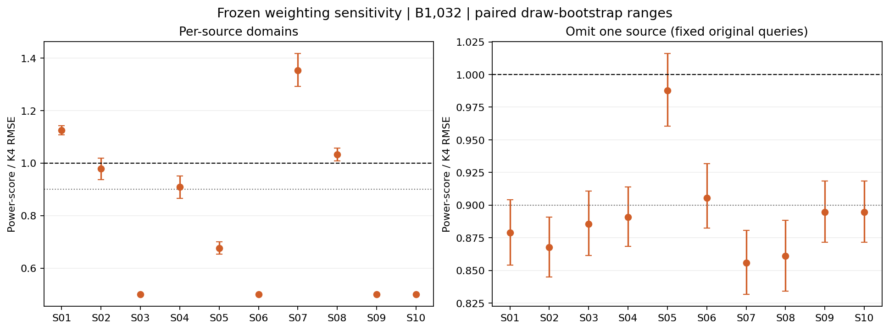

# Source sensitivity E: frozen-policy robustness

No new queries, labels, training or inference. Both estimators reuse original query inclusion weights and known public domain sizes. The policy, lambda0.5, strata and budgets remain fixed. This analysis was registered after D outcomes.

At B1032, weighting reduces RMSE in 10/10 leave-one-source-out domains; 8/10 show at least10% reduction. The worst ratio is 0.9876. These overlapping domains are not independent replications.
The gain is uneven: three of six positive-reference sources improve and three lose. Four zero-positive sources have exactly half the original error because lambda0.5 scales their residual-only errors; this is not independent evidence of better gaze recognition. Omitting S05 weakens the aggregate gain to about 1.2%, with a draw-bootstrap range including a tie. Keep this qualification.

| Domain | Alias | N | Positive references | K4 RMSE pp | Weighted RMSE pp | Ratio | MC95% range | Weighted normal coverage |
| --- | --- | ---: | ---: | ---: | ---: | ---: | --- | ---: |
| source | S01 | 336 | 57 | 2.1328 | 2.3991 | 1.1249 | [1.1073, 1.1426] | 0.941 |
| source | S02 | 270 | 48 | 2.7849 | 2.7251 | 0.9785 | [0.9366, 1.0197] | 0.937 |
| source | S03 | 1512 | 0 | 0.2923 | 0.1461 | 0.5000 | [0.5, 0.5] | 0.944 |
| source | S04 | 1152 | 14 | 0.2925 | 0.2658 | 0.9088 | [0.8664, 0.9514] | 0.948 |
| source | S05 | 709 | 111 | 2.2568 | 1.5270 | 0.6766 | [0.6527, 0.7004] | 0.945 |
| source | S06 | 392 | 0 | 1.5994 | 0.7997 | 0.5000 | [0.5, 0.5] | 0.942 |
| source | S07 | 5073 | 49 | 0.0803 | 0.1086 | 1.3534 | [1.293, 1.4177] | 0.946 |
| source | S08 | 332 | 84 | 2.7780 | 2.8705 | 1.0333 | [1.0087, 1.0563] | 0.959 |
| source | S09 | 251 | 0 | 0.0547 | 0.0274 | 0.5000 | [0.5, 0.5] | 0.860 |
| source | S10 | 289 | 0 | 0.0013 | 0.0006 | 0.5000 | [0.5, 0.5] | 0.674 |
| leave-out | S01 | 9980 | 306 | 0.2106 | 0.1851 | 0.8790 | [0.854, 0.9042] | 0.951 |
| leave-out | S02 | 10046 | 315 | 0.2140 | 0.1857 | 0.8679 | [0.845, 0.8908] | 0.941 |
| leave-out | S03 | 8804 | 363 | 0.2574 | 0.2279 | 0.8857 | [0.8614, 0.9109] | 0.950 |
| leave-out | S04 | 9164 | 349 | 0.2456 | 0.2188 | 0.8908 | [0.8686, 0.9141] | 0.949 |
| leave-out | S05 | 9607 | 252 | 0.1732 | 0.1711 | 0.9876 | [0.9603, 1.0162] | 0.950 |
| leave-out | S06 | 9924 | 363 | 0.2234 | 0.2023 | 0.9057 | [0.8824, 0.9317] | 0.948 |
| leave-out | S07 | 5243 | 314 | 0.4342 | 0.3717 | 0.8560 | [0.8317, 0.8807] | 0.941 |
| leave-out | S08 | 9984 | 279 | 0.2033 | 0.1750 | 0.8610 | [0.8343, 0.8883] | 0.947 |
| leave-out | S09 | 10065 | 363 | 0.2254 | 0.2016 | 0.8946 | [0.8715, 0.9185] | 0.947 |
| leave-out | S10 | 10027 | 363 | 0.2262 | 0.2024 | 0.8947 | [0.8716, 0.9186] | 0.947 |

All four budgets, zero-query rates, zero-variance rates, exact design RMSE and all source outcomes are retained in the aggregate JSON. Domain normal intervals can be unstable with few queried residuals. No domain-specific exact binary interval is claimed here. The conservative whole-population reference intervals from D are unchanged.

The bootstrap resamples saved draw indices, not sources. Omitted-source estimates still use the original global sampling allocation, and realized domain label counts vary; these are not new equal-budget nine-source experiments. No source is removed from the main report or used to retune the method. An unseen-source evaluation remains future work.

Reproduce with scripts/run_source_stress.py, then scripts/report_source_stress.py in the plotting environment. Existing numerical outputs refuse overwrite; use a new versioned config/output to rerun.
