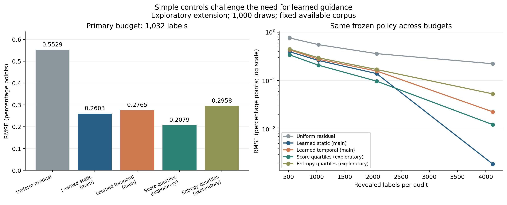
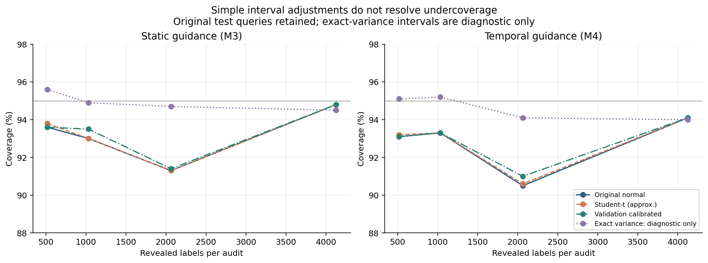
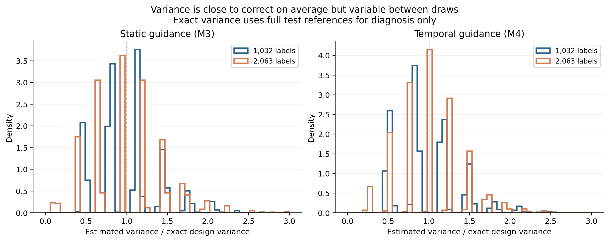
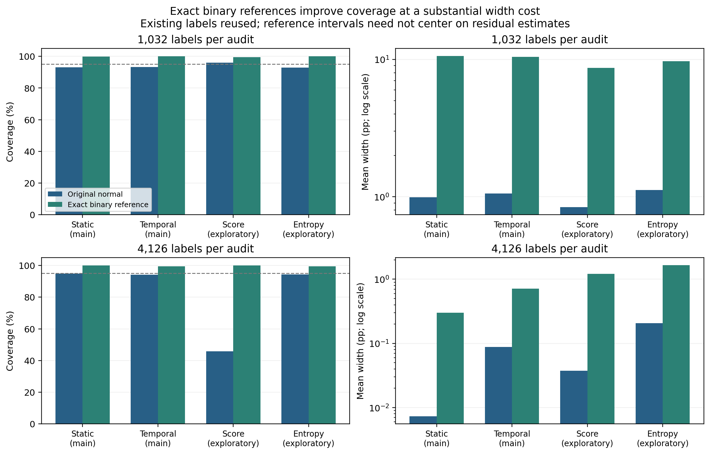

# Strengthening the social-gaze course project

Registered exploratory extension, 7 November 2026. The original main study and
A1/A2 remain unchanged. This round adds simpler controls, uncertainty diagnosis,
an exact binary reference and a working local demonstration.

**The strongest new result is that native-score quartiles outperform the learned
static error policy at the primary budget.** The project supports a useful simpler
approach on this corpus, rather than a claim that additional temporal complexity
is necessary. Its confidence-interval limitations are equally important.

## Registered simple controls (B1)

Both controls use public training-feature quartile cuts, training residual SD
moments and validation-selected alpha 1. There is no trained error predictor,
but historical training/validation labels are still a development cost. All
8,000 new control evaluations passed independent RNG, point, variance and RMSE
checks. Queries and policies were saved before oracle access.

RMSE is in percentage points, at exact equal budgets:

| Method | 516 labels | 1,032 labels | 2,063 labels | 4,126 labels |
| --- | ---: | ---: | ---: | ---: |
| Uniform residual (main) | 0.7606 | 0.5529 | 0.3607 | 0.2230 |
| Learned static (main) | 0.3950 | 0.2603 | 0.1396 | 0.0019 |
| Learned temporal (main) | 0.4351 | 0.2765 | 0.1580 | 0.0227 |
| Score quartiles (exploratory) | 0.3407 | 0.2079 | 0.0974 | 0.0123 |
| Entropy quartiles (exploratory) | 0.4484 | 0.2958 | 0.1697 | 0.0532 |

At 1,032 labels, score quartiles reduce RMSE by 62.4% versus uniform residual
correction and 20.1% versus learned static guidance. M3/score RMSE ratio is
1.2523 [1.1722, 1.3369]; M3/entropy is 0.8801 [0.8225, 0.9369]. Intervals use
2,000 draw-bootstrap resamples, seed 400002, and describe Monte Carlo variability
on this fixed corpus. Different registered streams do not imply identical queries.
No method universally wins: score guidance leads at 5%,10%,20%; learned static
leads at 40%, where its high-error strata are censused.

Entropy is symmetric in q and 1-q, so it can pool confident positive and negative
predictions. Raw score strata retain that distinction. This is a plausible
explanation for the difference between these two controls on an overpredicting
model; this experiment does not establish that explanation causally.

**The score control's normal interval covers 96.0% at 10% labels but only 45.9%
at 40%.** Entropy coverage is 94.8%,92.9%,89.3%,94.3% across budgets. Neither low
point error nor a narrow interval alone establishes reliable uncertainty. No
failed, zero-positive or zero-variance control draw was observed.

## Interval diagnosis and development calibration (B2)

The main M3/M4 query plans, partitions, estimates and original intervals are
retained. Eight thousand fresh validation draws set eight interval multipliers
before new test diagnostics. Another 8,000 existing test draws were independently
recomputed; these are reused audits, not new independent experiments.

At the primary budget:

| Method | Interval | Coverage | Mean width (pp) |
| --- | --- | ---: | ---: |
| M3 | Original normal | 93.0% | 0.9911 |
| M3 | Student-t, approximate | 93.0% | 0.9956 |
| M3 | Validation calibrated | 93.5% | 1.0034 |
| M3 | Exact variance, evaluation only | 94.9% | 1.0067 |
| M4 | Original normal | 93.3% | 1.0560 |
| M4 | Student-t, approximate | 93.3% | 1.0599 |
| M4 | Validation calibrated | 93.3% | 1.0560 |
| M4 | Exact variance, evaluation only | 95.2% | 1.0876 |

The average estimated/exact variance ratio is 1.007 for M3 and 0.980 for M4 at
10%. But its 5th–95th percentiles span 0.464–1.755 / 0.485–1.568. Effective df
are already large, so Student-t barely changes the normal interval. Development
multipliers do not reliably transfer: at 20%, calibrated coverage remains only
91.4% / 91.0%. Calibration reused the development corpus and supplies no
new-source or distribution-free guarantee. It was not tuned on test coverage.

### Post-hoc residual-tail explanation

A descriptive check, added after B2 outcomes, defines tails as
abs(residual minus its full-test stratum mean)>0.5. These full-reference quantities
are evaluator diagnostics and never policy inputs. In stratum 1, both main
policies have only 26 such tail records; the largest 10 centered squared residuals
account for about 38% of that stratum's residual sum of squares. Twenty-five
records have residual below -0.5, showing that large false-positive errors, rather
than simply zero sampled positive labels, matter.

At 10%, M3 misses all these tails in 17.5% of draws; conditional normal coverage
then falls to 72.0%. For M4, 23.5% of draws miss them and coverage is 78.7%.
At 20%, M3/M4 miss them in 2.7% / 4.5% of draws, with coverage 0% / 17.8% in
those small subsets. Conditional groups are outcome-aware descriptions, not
causal identification or independent confirmations. They are consistent with
rare large residuals causing draw-specific variance underestimation.

## Exact stratified binary reference (B2b)

This additional construction was registered separately after the observed score
control coverage failure. It reuses the same 16,000 main/control audit cases;
there are no extra labels or policies. Exact hypergeometric intervals for binary
stratum totals spend alpha equally across non-census strata, then combine
weighted endpoints. Census contributions are exact. Individual tail conditions,
neighboring integer boundaries, exhaustive small-population coverage and saved
aggregate recomputation were checked.

The simultaneous construction uses the
[NIST-documented Bonferroni bound](https://itl.nist.gov/div898/handbook/prc/section4/prc473.htm)
with hypergeometric finite-population sampling. Conditional on the fixed binary
population and specified sampling design, it targets at least nominal coverage;
it does not cover incorrect labels, alignment failures or new-source transfer.
This is established statistical machinery rather than a new theorem.

At 1,032 labels:

| Method | Original normal coverage | Exact binary coverage | Normal width (pp) | Exact width (pp) |
| --- | ---: | ---: | ---: | ---: |
| M3 | 93.0% | 99.9% | 0.9911 | 10.5970 |
| M4 | 93.3% | 100.0% | 1.0560 | 10.4595 |
| q-quartiles | 96.0% | 99.4% | 0.8402 | 8.6960 |
| entropy-quartiles | 92.9% | 100.0% | 1.1189 | 9.6868 |

Coverage improves at a substantial width cost. At 40%, score normal/exact
coverage is 45.9% / 100%, but mean width grows from 0.0374 to 1.2078 pp. At
10%, exact widths of about 8.7–10.6 pp remain impractically broad for many uses,
even though narrower than the original bounded-residual reference.

The binary reference ignores q and is generally centered differently from the
residual point estimate. At 40%, the retained M3 point lies outside this binary
interval in 50.6% of draws; score quartiles do so in 27.3%. This is reported,
not repaired by clipping: observed census positives impose a binary lower total,
while the residual estimator can fluctuate below it. Use this interval as a
separate prevalence reference, not as an exact residual-centered error bar.

## Demonstration, verification and costs

The [local explorer](http://127.0.0.1:8765) has Results, Audit replay and Method &
limits panels. It replays all seven main/control methods, four budgets and 1,000
saved draws, checks hashes and original point/variance values, displays public
score/query timelines and downloaded frames with supplied track boxes, separates
queried labels from benchmark truth, and exports a reproducible summary.
The original normal interval remains labelled in live replay; exact references
are presented separately here rather than replacing the locked display.

Browser checks covered desktop and 390-pixel layouts, label/truth toggles, actual
media, budget-dependent findings, the download and all three panels. Nine live
API cases, invalid input/path rejection and image delivery passed. No browser
console errors were observed. No Node runtime is required for the demo. See the
[demo guide](../../docs/DEMO_GUIDE.md) and
[presentation walkthrough](../../docs/PROJECT_PRESENTATION.md).

Software: **43 tests pass**, including exhaustive two-stratum design coverage and
an integer census-boundary regression; Ruff passes. Four new figures were viewed
and checked. Main evaluation/policy hashes remain unchanged. New successful CPU
stages took about 65.3 seconds (B1), 141.0 seconds (B2) and 20.2 seconds (B2b v2),
plus diagnostics, validation and rendering. No additional GPU inference or new
human annotation occurred. Historical development-label costs remain disclosed.

Two implementation failures are preserved: a NumPy-bool JSON serialization issue
in the post-hoc tail diagnostic, and floating census-boundary/CSV comparisons in
the first exact-interval run. Both were repaired in new versioned outputs. The
accepted exact implementation adds feasible integer totals before division and
scores coverage on that integer population grid; it does not treat the failed
run's zero coverage as a scientific finding.

The appropriate course conclusion is a reproducible comparison showing when
simple guidance can beat learned temporal/static guidance, with explicit coverage
failures and conservative reference intervals. There is no general superiority,
clinical-validation, measured annotation-time or statistical-novelty claim.
Protocols and full aggregates: [strengthening registration](../../docs/STRENGTHENING_EXPERIMENTS.md),
[exact registration](../../docs/EXACT_INTERVAL_EXTENSION.md),
[evidence manifest](../../docs/research/strengthening-evidence-manifest.json).
