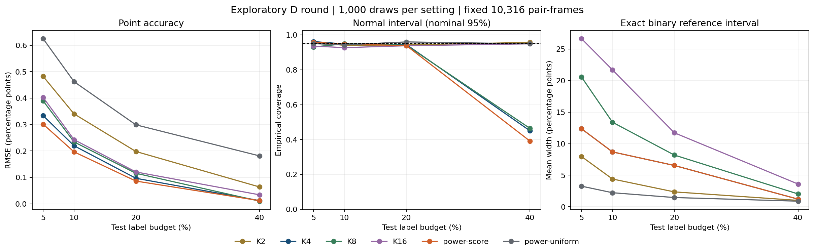
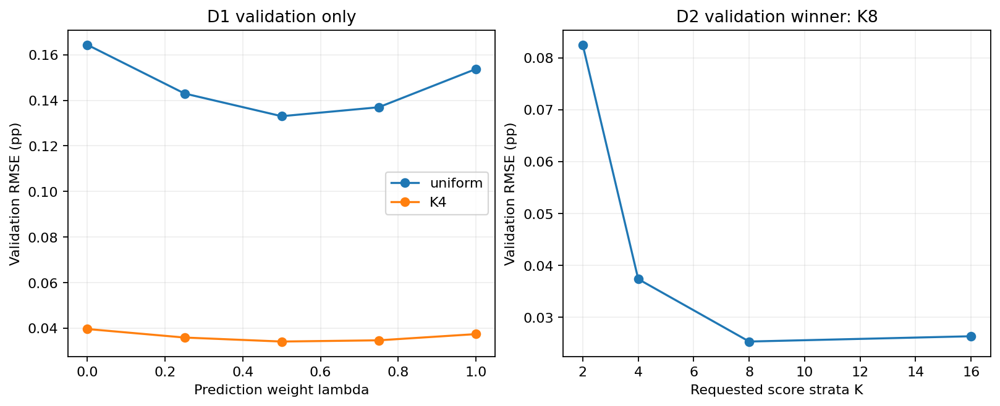

# Timed research D: results appendix

Exploratory results after repeated inspection of the same test corpus. All settings were registered before these outcomes. The main submission remains frozen.

Completed 24,000 test method-draw evaluations, independently replayed and recomputed; CPU run 275.5 seconds, no new GPU inference.

Validation selected weights: {'uniform': 0.5, 'K4': 0.5}; D2 selected K8. All four K variants are retained below. Each uses 191,956 training and 25,139 reused validation labels; this excludes historical backbone supervision.

| Policy | B | Bias pp | MAE pp | RMSE pp | Normal coverage | Normal width pp | Exact coverage | Exact width pp |
| --- | ---: | ---: | ---: | ---: | ---: | ---: | ---: | ---: |
| K2 | 516 | 0.0126 | 0.3809 | 0.4823 | 0.959 | 1.9597 | 0.986 | 7.9598 |
| K2 | 1032 | -0.0001 | 0.2771 | 0.3404 | 0.940 | 1.2997 | 0.982 | 4.4003 |
| K2 | 2063 | 0.0041 | 0.1570 | 0.1982 | 0.943 | 0.7777 | 0.990 | 2.3565 |
| K2 | 4126 | 0.0033 | 0.0511 | 0.0639 | 0.957 | 0.2521 | 0.988 | 1.0066 |
| K4 | 516 | 0.0124 | 0.2676 | 0.3338 | 0.962 | 1.3728 | 0.993 | 12.3603 |
| K4 | 1032 | 0.0048 | 0.1740 | 0.2199 | 0.948 | 0.8416 | 0.996 | 8.6978 |
| K4 | 2063 | 0.0044 | 0.0768 | 0.0969 | 0.945 | 0.3645 | 0.994 | 6.5458 |
| K4 | 4126 | 0.0002 | 0.0117 | 0.0124 | 0.450 | 0.0368 | 1.000 | 1.2075 |
| K8 | 516 | -0.0059 | 0.3170 | 0.3896 | 0.931 | 1.4755 | 1.000 | 20.5665 |
| K8 | 1032 | 0.0044 | 0.1865 | 0.2344 | 0.949 | 0.9299 | 1.000 | 13.4032 |
| K8 | 2063 | 0.0022 | 0.0928 | 0.1158 | 0.941 | 0.4517 | 0.996 | 8.1996 |
| K8 | 4126 | -0.0001 | 0.0102 | 0.0103 | 0.464 | 0.0302 | 1.000 | 2.0298 |
| K16 | 516 | -0.0089 | 0.3223 | 0.4029 | 0.936 | 1.5327 | 1.000 | 26.6552 |
| K16 | 1032 | 0.0186 | 0.1924 | 0.2430 | 0.927 | 0.9669 | 1.000 | 21.7081 |
| K16 | 2063 | -0.0013 | 0.0969 | 0.1208 | 0.938 | 0.4734 | 1.000 | 11.7323 |
| K16 | 4126 | -0.0004 | 0.0275 | 0.0343 | 0.949 | 0.1330 | 1.000 | 3.6038 |
| power-score | 516 | 0.0120 | 0.2406 | 0.3015 | 0.958 | 1.2163 | 0.993 | 12.3603 |
| power-score | 1032 | 0.0067 | 0.1560 | 0.1967 | 0.947 | 0.7462 | 0.996 | 8.6978 |
| power-score | 2063 | 0.0038 | 0.0684 | 0.0863 | 0.939 | 0.3256 | 0.994 | 6.5458 |
| power-score | 4126 | 0.0001 | 0.0118 | 0.0122 | 0.391 | 0.0333 | 1.000 | 1.2075 |
| power-uniform | 516 | -0.0127 | 0.4944 | 0.6248 | 0.950 | 2.5176 | 0.970 | 3.2635 |
| power-uniform | 1032 | 0.0117 | 0.3680 | 0.4622 | 0.943 | 1.7490 | 0.954 | 2.2241 |
| power-uniform | 2063 | 0.0014 | 0.2427 | 0.2990 | 0.960 | 1.1663 | 0.955 | 1.4607 |
| power-uniform | 4126 | 0.0048 | 0.1441 | 0.1814 | 0.949 | 0.7149 | 0.961 | 0.8849 |

## Registered primary comparisons

| Comparison at B1032 | RMSE ratio | Draw-bootstrap 95% range | Meets registered practical threshold |
| --- | ---: | --- | --- |
| power-score / K4 | 0.8947 | [0.8712, 0.9190] | True |
| K8 / K4 | 1.0661 | [1.0013, 1.1355] | False |
| power-uniform / original M2 | 0.8360 | [0.8096, 0.8652] | Secondary |

The bootstrap describes simulation error on this fixed corpus, not generalization to new children/videos. Validation-selected K is the D2 endpoint even if another K looks better on test. No combined lambda/K policy was tested.
D1 score/K4 and uniform/M2 use identical queried records. Across K, stream21 aligns random seeds but the designs differ. The inherited generic raw-JSON scope text saying streams differ is imprecise; the saved arrays were checked.

The exact binary reference is a conservative, separately centered interval for the same finite population. It does not validate the residual-centered normal interval and may exclude the residual point estimate. Normal undercoverage, all high-budget behavior and all failed comparisons remain in the tables and aggregate JSON.

A primary threshold pass is an exploratory engineering improvement, not a new statistical method or an independent replication. The original temporal-versus-static finding is unchanged. These results estimate benchmark-defined mutual looking, not ADHD diagnosis.
The prior B1 score-control run reported 0.2079 pp at B1032 on stream7. This round's unweighted control is 0.2199 pp on stream21; the registered 10.5% gain compares identical stream21 queries. Relative to the old simulation number, the weighted 0.1967 pp is about 5.4% lower. This is not a new dataset.
A post-hoc evaluation-only calculation using full test references gives exact design RMSE 0.2160 pp for K4 and 0.1920 pp for power-score at B1032 (about 11.1% lower). This explains the fixed-population variance reduction; it does not select a new policy or establish transfer to unseen sources.





## Reproduction

```powershell
.venv/Scripts/python.exe scripts/run_timed_research.py
.venv/Scripts/python.exe scripts/validate_timed_research.py
.venv/Scripts/python.exe scripts/check_timed_comparisons.py
.venv-mtgs/Scripts/python.exe scripts/report_timed_research.py
```

Reruns require a new versioned config/output path; existing evidence is never overwritten. Protocol: docs/TIMED_RESEARCH_D.md. Research links: docs/research/timed-d-literature.md.
