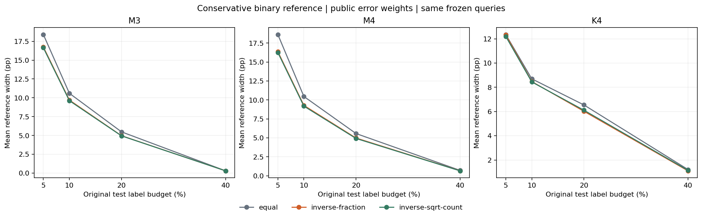

# Public-weight exact reference intervals F

The primary interval-width ratio is 0.974098: a 2.59% reduction, below the registered descriptive10% target. No point-estimate improvement is claimed. The original normal interval failures and equal-error references stay intact.

Weighted Bonferroni error allowances are fixed from public stratum sizes/query counts. Exact hypergeometric stratum intervals plus the union bound give at least95% finite-population coverage under the stated SRS design. This is a standard construction, not a new theorem or an unseen-source validation.

| Design | B | Recipe | Coverage | Mean width pp | Residual point outside rate |
| --- | ---: | --- | ---: | ---: | ---: |
| M3 | 516 | equal | 1.000 | 18.4080 | 0.003 |
| M3 | 516 | inverse-fraction | 1.000 | 16.7535 | 0.000 |
| M3 | 516 | inverse-sqrt-count | 1.000 | 16.6477 | 0.001 |
| M3 | 1032 | equal | 0.999 | 10.5970 | 0.002 |
| M3 | 1032 | inverse-fraction | 1.000 | 9.6960 | 0.000 |
| M3 | 1032 | inverse-sqrt-count | 1.000 | 9.6186 | 0.001 |
| M3 | 2063 | equal | 0.999 | 5.4812 | 0.007 |
| M3 | 2063 | inverse-fraction | 1.000 | 4.9686 | 0.001 |
| M3 | 2063 | inverse-sqrt-count | 1.000 | 4.9501 | 0.002 |
| M3 | 4126 | equal | 1.000 | 0.3005 | 0.506 |
| M3 | 4126 | inverse-fraction | 1.000 | 0.3005 | 0.506 |
| M3 | 4126 | inverse-sqrt-count | 1.000 | 0.3005 | 0.506 |
| M4 | 516 | equal | 1.000 | 18.6320 | 0.001 |
| M4 | 516 | inverse-fraction | 1.000 | 16.3743 | 0.001 |
| M4 | 516 | inverse-sqrt-count | 1.000 | 16.2609 | 0.001 |
| M4 | 1032 | equal | 1.000 | 10.4595 | 0.003 |
| M4 | 1032 | inverse-fraction | 1.000 | 9.2813 | 0.001 |
| M4 | 1032 | inverse-sqrt-count | 1.000 | 9.1864 | 0.001 |
| M4 | 2063 | equal | 1.000 | 5.5762 | 0.007 |
| M4 | 2063 | inverse-fraction | 1.000 | 4.9846 | 0.003 |
| M4 | 2063 | inverse-sqrt-count | 1.000 | 4.9276 | 0.003 |
| M4 | 4126 | equal | 0.994 | 0.7117 | 0.014 |
| M4 | 4126 | inverse-fraction | 1.000 | 0.6645 | 0.005 |
| M4 | 4126 | inverse-sqrt-count | 1.000 | 0.6530 | 0.005 |
| K4 | 516 | equal | 0.993 | 12.3603 | 0.005 |
| K4 | 516 | inverse-fraction | 1.000 | 12.3229 | 0.002 |
| K4 | 516 | inverse-sqrt-count | 1.000 | 12.2075 | 0.002 |
| K4 | 1032 | equal | 0.996 | 8.6978 | 0.004 |
| K4 | 1032 | inverse-fraction | 1.000 | 8.4725 | 0.000 |
| K4 | 1032 | inverse-sqrt-count | 0.999 | 8.4420 | 0.000 |
| K4 | 2063 | equal | 0.994 | 6.5458 | 0.005 |
| K4 | 2063 | inverse-fraction | 1.000 | 6.0232 | 0.000 |
| K4 | 2063 | inverse-sqrt-count | 0.997 | 6.1099 | 0.000 |
| K4 | 4126 | equal | 1.000 | 1.2075 | 0.294 |
| K4 | 4126 | inverse-fraction | 1.000 | 1.1009 | 0.294 |
| K4 | 4126 | inverse-sqrt-count | 1.000 | 1.1396 | 0.294 |
| power-uniform | 516 | equal | 0.970 | 3.2635 | 0.000 |
| power-uniform | 516 | inverse-fraction | 0.970 | 3.2635 | 0.000 |
| power-uniform | 516 | inverse-sqrt-count | 0.970 | 3.2635 | 0.000 |
| power-uniform | 1032 | equal | 0.954 | 2.2241 | 0.000 |
| power-uniform | 1032 | inverse-fraction | 0.954 | 2.2241 | 0.000 |
| power-uniform | 1032 | inverse-sqrt-count | 0.954 | 2.2241 | 0.000 |
| power-uniform | 2063 | equal | 0.955 | 1.4607 | 0.000 |
| power-uniform | 2063 | inverse-fraction | 0.955 | 1.4607 | 0.000 |
| power-uniform | 2063 | inverse-sqrt-count | 0.955 | 1.4607 | 0.000 |
| power-uniform | 4126 | equal | 0.961 | 0.8849 | 0.000 |
| power-uniform | 4126 | inverse-fraction | 0.961 | 0.8849 | 0.000 |
| power-uniform | 4126 | inverse-sqrt-count | 0.961 | 0.8849 | 0.000 |

The primary same-draw width-ratio Monte Carlo95% range is [0.9740154988287071, 0.9741800245978219]. The range describes simulation variability on the fixed corpus, not uncertainty about performance on new videos.

At B1032 the primary score design remains broad (over8 pp). The temporal M4 inverse-fraction interval has about11% less width than its equal-error reference, but remains over9 pp wide; this is secondary and does not rescue temporal point accuracy. Uniform sampling has one stratum, so all recipes are identical as required.

These binary intervals estimate the same prevalence but are not centered on the residual-correction point. They can exclude that point; no clipping or intersection with normal/equal intervals is used. Choosing a recipe after observing labels is not covered by this fixed-weight construction.

All48,000 saved integer endpoint cases passed independent allocation, endpoint/tail and saved-summary checks. Equal recipes reproduce prior exact intervals. The exhaustive synthetic tests cover all binary population totals for a small two-stratum design. No new queried labels or GPU inference were used.

Protocol: docs/WEIGHTED_INTERVALS_F.md. Run scripts/run_weighted_intervals.py --config configs/weighted-intervals-f-v2.json, then scripts/validate_weighted_intervals.py in the CPU environment and scripts/report_weighted_intervals.py in the plotting environment. Existing numerical/verification outputs refuse overwrite.

The failed v1 output-row container bug is retained with its log. Accepted v2 fixes only that container and adds a configuration argument; recipes/endpoints are unchanged.
